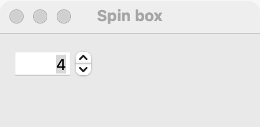

# Spin box

`GUI_SPIN_BOX` holds a whole number in a range, which the user types or steps up and down. Use a spin box when the exact value matters, such as a count, a port number or a page number. When an approximate value is fine and the user wants to see it change as they drag (volume, zoom, brightness), use a [slider](slider.md).

## Example

```eiffel
class SPIN_BOX_DEMO create make
feature
	app: GUI_APPLICATION
	label: GUI_LABEL

	make
		local
			l_window: GUI_WINDOW
			l_stack: GUI_STACK
			l_spin: GUI_SPIN_BOX
		do
			create app.make ("Spin box demo", "org.simple-eiffel.spin-box-demo")
			create l_window.make ("Spin box", 320, 140)
			create l_stack.make_vertical
			create l_spin.make (1, 99)
			l_spin.set_value (3)
			l_spin.set_accessible_label ("Copies")
			create label.make ("3 copies")
			l_spin.change_actions.extend (agent show_copies)
			l_stack.extend (l_spin)
			l_stack.extend (label)
			l_window.set_content (l_stack)
			l_window.show
			app.run
		end

	show_copies (a_value: INTEGER)
		do
			label.set_text (a_value.out + " copies")
		end
end
```

## Try it

The window shows a spin box holding 3 and the label "3 copies". Click its up arrow: `change_actions` run with 4 and the label shows "4 copies". Type 15 and press Return (or move to another control): the label shows "15 copies". Type 500: the box clamps it to 99. Type "abc": the box goes back to the last value, with no event.

## API

| Feature | What it does |
|---|---|
| `make (a_min, a_max)` | Makes a spin box from `a_min` to `a_max`, showing `a_min`, stepping by 1. Requires `a_min <= a_max`. |
| `value` | The number shown. Always `minimum <= value and value <= maximum`. |
| `set_value (a_value)` | Shows `a_value`, without a change event. Requires `minimum <= a_value and a_value <= maximum`. |
| `minimum` | The lowest value. |
| `maximum` | The highest value. |
| `step` | How far one up or down moves the value. |
| `set_step (a_step)` | Sets the step. Requires `a_step > 0`. |
| `change_actions` | Agents run when the user changes the value, with `value: INTEGER`. |

Every creation procedure requires `is_gui_thread` and `has_application`; every command requires `is_gui_thread`. See also [common features](widget.md).

**Events:** `change_actions` run with the new value when the user commits a change: a step click, Return, or leaving the field. They do not run on each keystroke, since typing 15 into a 10 to 20 box passes through 1. A typed value out of range is clamped to `minimum` or `maximum`; text that is not a number goes back to the last value, with no event. Typed values are not snapped to `step`. `set_value` never fires `change_actions`; its contract ensures `change_actions.fire_count = old change_actions.fire_count`.

**Accessibility:** the role is `spin-button`. Give it `set_accessible_label`; it has no visible text that names it.

## On each platform

| | Linux (GTK 4) | macOS (AppKit) | Windows (simple_widgets) |
|---|---|---|---|
| Native control | `GtkSpinButton`, numbers only, no decimals | An `NSTextField` with an `NSStepper` beside it, in one view | `SW_NUMBER_BOX`, drawn |
| Looks or behaves differently | Page Up and Page Down move ten steps. | The number is right-aligned and always left to right. The field is wide enough for the range's longest number. The stepper does not wrap from the maximum to the minimum. | — <!-- PROD: confirm --> |

## Design guidance

- Keep a spin box at its natural width; it is sized for the numbers it can hold.
- Put a [label](label.md) before it ("Copies:") and give it `set_accessible_label` with the same words. Put a unit after it in another label if there is one.
- Choose a range that fits the task. Very wide ranges (0 to a million) are faster to type than to step; a [slider](slider.md) cannot hit exact values in them either.
- Use `set_step` for values that only make sense in steps (5, 10, 15 minutes), but remember typed values are not snapped.
- For a value the user judges by eye, use a [slider](slider.md).

## Gallery

| Linux | macOS | Windows |
|---|---|---|
| <!-- PROD: Linux picture --> |  | <!-- PROD: Windows picture --> |
