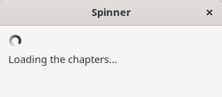
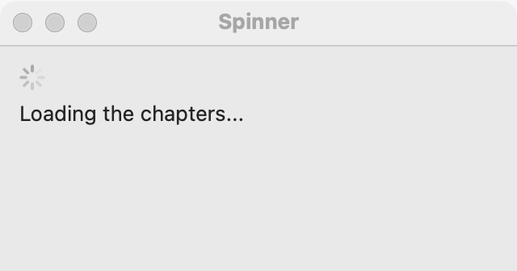
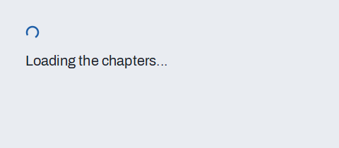

# Spinner

`GUI_SPINNER` is a small turning wheel that says "working, no telling how long". It is a progress bar with no value. Use it while the program waits for something with no known end, such as a server's answer. For work with a known end, use a [progress bar](progress-bar.md); for the wait of a single button, the button's own busy state (`set_busy`, see [Icons and badges](icons-and-badges.md)) already shows a spinner.

## Example

```eiffel
class SPINNER_DEMO create make
feature
	app: GUI_APPLICATION
	spinner: GUI_SPINNER
	toggle: GUI_BUTTON

	make
		local
			l_window: GUI_WINDOW
			l_stack: GUI_STACK
		do
			create app.make ("Spinner demo", "org.simple-eiffel.spinner-demo")
			create l_window.make ("Spinner", 320, 140)
			create l_stack.make_vertical
			create spinner.make
			spinner.set_accessible_label ("Loading")
			create toggle.make ("Start")
			toggle.click_actions.extend (agent flip)
			l_stack.extend (spinner)
			l_stack.extend (toggle)
			l_window.set_content (l_stack)
			l_window.show
			app.run
		end

	flip
		do
			if spinner.is_spinning then
				spinner.stop
				toggle.set_text ("Start")
			else
				spinner.start
				toggle.set_text ("Stop")
			end
		end
end
```

## Try it

The window shows a still wheel and a **Start** button. Press it: the wheel turns and the button reads **Stop**. Press again: the wheel stops.

## API

| Feature | What it does |
|---|---|
| `make` | A spinner, not turning yet. Requires `is_gui_thread` and `has_application`. Ensures `not is_spinning`. |
| `start` | Starts the wheel turning. Requires `is_gui_thread`. Ensures `is_spinning`. |
| `stop` | Stops it. Requires `is_gui_thread`. Ensures `not is_spinning`. |
| `is_spinning` | Is the wheel turning? |

Inherited: `set_accessible_label`, `set_tooltip`, `show`, `hide` and the rest of the [common features](widget.md).

**Events:** none. The user cannot change a spinner, and `start` and `stop` fire nothing.

**Accessibility:** it reads as a progress bar with no value (`progress-bar`, indeterminate). It has no text of its own, so give it `set_accessible_label` with the task ("Loading", "Searching").

## On each platform

| | Linux (GTK 4) | macOS (AppKit) | Windows (simple_widgets) |
|---|---|---|---|
| Native control | `GtkSpinner`, 20 by 20 logical pixels, aligned to the start | `NSProgressIndicator`, spinning style | `SW_SPINNER`, a drawn ring of size 20 |
| Looks or behaves differently | Keeps its small size and does not stretch. | The same small wheel. | The ring turns on the windows' fast timer, which is paced up while a spinner is turning. |

## Design guidance

- Show the spinner only while work runs, and `stop` it when the work ends or fails. A wheel that turns forever with nothing behind it is worse than none.
- Put it next to what is loading, with a line of text saying what ("Searching 3 libraries..."); the wheel shows that something happens, the text shows what.
- If you can tell how far along the task is, use a [progress bar](progress-bar.md) instead.
- Start and stop it from the GUI processor only. A worker reports through `GUI_APPLICATION.mailbox` (see [Getting started](getting-started.md)).

## Gallery

| Linux | macOS | Windows |
|---|---|---|
|  |  |  |
