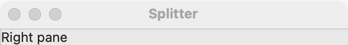

# Splitter

`GUI_SPLITTER` shows two panes with a divider between them that the user drags to share the room. Use it for a list beside its details, a source beside its preview, or anything where the user decides how much each side gets. When only one part shows at a time, use [tabs](tabs.md); when the sizes are fixed, use a [stack](stack.md).

## Example

```eiffel
class LIBRARY create make
feature
	app: GUI_APPLICATION
	books: GUI_LIST
	split: GUI_SPLITTER
	shown: GUI_LABEL

	make
		local
			l_window: GUI_WINDOW
		do
			create app.make ("Library", "org.example.library")
			create l_window.make ("Library", 520, 280)
			create split.make_horizontal
			create books.make
			books.set_accessible_label ("Books")
			books.extend ("Genesis")
			books.extend ("Exodus")
			books.extend ("Leviticus")
			create shown.make ("Pick a book.")
			books.selection_actions.extend (agent on_book)
			split.set_first (books)
			split.set_second (shown)
			split.set_position (180)
			l_window.set_content (split)
			l_window.show
			app.run
		end

	on_book (a_row: INTEGER)
		do
			if a_row > 0 then
				shown.set_text (books.i_th (a_row) + {STRING_32} " (divider at " + split.position.out + ")")
			end
		end
end
```

## Try it

A window opens with a list of three books on the leading side, 180 logical pixels wide, and the line "Pick a book." in the other pane. Drag the divider to resize the panes. Pick a book: the line shows its name and where the divider is now, for example "Exodus (divider at 214)". Moving the divider fires no event; the program reads `position` when it needs it.

## API

| Feature | What it does |
|---|---|
| `make_horizontal` | Two panes side by side. Ensures `not is_vertical` and `count = 0`. |
| `make_vertical` | Two panes, one above the other. Ensures `is_vertical` and `count = 0`. |
| `set_first (a_widget)` | Puts `a_widget` in the leading (or top) pane. Requires `first = Void`, `a_widget.parent = Void` and `a_widget /= Current`. Ensures `first = a_widget`. |
| `set_second (a_widget)` | Puts `a_widget` in the trailing (or bottom) pane. Requires `second = Void`, `a_widget.parent = Void` and `a_widget /= Current`. Ensures `second = a_widget`. |
| `first`, `second` | The widgets in the panes, once set. |
| `position` | Where the divider is: logical pixels from the leading edge (or the top). Always >= 0. |
| `set_position (a_position)` | Moves the divider to `a_position` logical pixels from the leading edge (or the top), as far as the panes allow. Requires `a_position >= 0`. No event. |
| `is_vertical` | Are the panes stacked (rather than side by side)? |
| `children`, `count`, `has (a_widget)` | The panes' widgets (from `GUI_CONTAINER`); a splitter holds at most two. |

Inherited: `set_base_direction`, `show`, `hide` and the rest of the [common features](widget.md).

**Events:** none. `set_position` fires nothing, and the user's drag has no event: read `position` when you need it (for example, to save it when the window closes).

**Accessibility:** a screen reader goes through the panes; the divider itself is the toolkit's. On macOS the splitter reads as `generic`, which `describe_accessibility` skips. <!-- PROD: confirm the role on GTK and Windows --> Label the panes' contents, not the splitter.

**Sizes.** When the splitter grows, the first pane keeps its size and the second takes the change. A position set before the window shows is kept and applied once the splitter has a size.

**Right to left.** "Horizontal" means side by side (GTK's naming). The first pane is the leading one: on the right under `Direction_right_to_left`, and `position` then counts from the right edge.

## On each platform

| | Linux (GTK 4) | macOS (AppKit) | Windows (simple_widgets) |
|---|---|---|---|
| Native control | `GtkPaned` | `NSSplitView` with a thin divider | `SW_SPLITTER`, in a holder column until both panes are set |
| Looks or behaves differently | Neither pane shrinks below its minimum size. | Each pane is a holder view with the widget pinned inside it, so pane 1 is always the leading one. | The divider is drawn with grip dots; neither pane can vanish. A position close to an edge holds. |

## Design guidance

- Put the part the user works in second, so it takes the room when the window grows; put a list or a sidebar first.
- Set a sensible starting `position` before showing the window, and save `position` when the window closes if the user should get it back next time.
- Make the splitter the window's content, or add it to a stack with `extend_stretching`: a splitter with no room to share is no use.
- Do not nest splitters more than once or twice; deep nests are hard to resize.
- Use `make_horizontal` for side-by-side panes; it mirrors under right to left with no work on your side.

## Gallery

| Linux | macOS | Windows |
|---|---|---|
| <!-- PROD: Linux picture --> |  | <!-- PROD: Windows picture --> |
