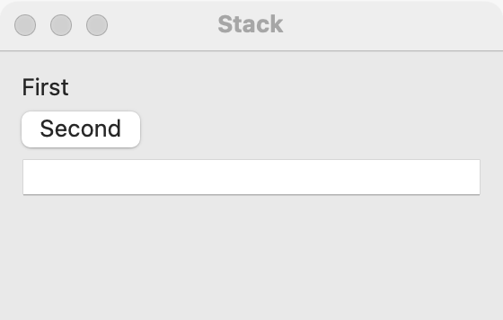

# Stack

`GUI_STACK` lays out widgets in one column (vertical) or one row (horizontal), in the order you add them. It is the container most windows start with. When widgets must line up in both directions, such as captions and fields in a form, use a [grid](grid.md). For two panes the user resizes, use a [splitter](splitter.md).

## Example

```eiffel
class COUNTER create make
feature
	app: GUI_APPLICATION
	area: GUI_TEXT_AREA
	shown: GUI_LABEL

	make
		local
			l_window: GUI_WINDOW
			l_column, l_row: GUI_STACK
			l_count: GUI_BUTTON
		do
			create app.make ("Counter", "org.example.counter")
			create l_window.make ("Counter", 400, 260)
			create l_column.make_vertical
			create l_row.make_horizontal
			create area.make
			area.set_accessible_label ("Text")
			create shown.make ("Type, then count.")
			create l_count.make ("Count")
			l_count.click_actions.extend (agent count_characters)
			l_column.extend_stretching (area)
			l_row.set_alignment (l_row.Align_center)
			l_row.extend_stretching (shown)
			l_row.extend (l_count)
			l_column.extend (l_row)
			l_window.set_content (l_column)
			l_window.show
			app.run
		end

	count_characters
		do
			shown.set_text (area.text.count.out + " characters")
		end
end
```

## Try it

A window opens with a text area on top and, under it, a row with the line "Type, then count." and a **Count** button at the trailing end. The text area takes all the height the row does not need, because it was added with `extend_stretching`; in the row, the label stretches and the button keeps its natural width. Type some text and press **Count**: the label shows how many characters you typed. Make the window larger and the text area grows with it.

## API

| Feature | What it does |
|---|---|
| `make_vertical` | An empty column. Ensures `is_vertical` and `count = 0`. |
| `make_horizontal` | An empty row. Ensures `not is_vertical` and `count = 0`. |
| `extend (a_widget)` | Adds `a_widget` at the end, at its natural size. Requires `a_widget.parent = Void` and `a_widget /= Current`. Ensures `a_widget.parent = Current` and `children.last = a_widget`. |
| `extend_stretching (a_widget)` | Adds `a_widget` at the end; it takes the spare space along the stack. Same contract as `extend`. |
| `extend_aligned (a_widget, an_alignment)` | Adds `a_widget` at the end, placed across the stack by `an_alignment`. Also requires `is_valid_alignment (an_alignment)`. |
| `set_alignment (an_alignment)` | Places every child, existing and later, across the stack. Requires `is_valid_alignment (an_alignment)`. |
| `alignment` | The alignment set by `set_alignment` (`Align_fill` until then). |
| `Align_fill`, `Align_start`, `Align_center`, `Align_end` | 0 to 3. `Align_fill` leaves each child to its own default. |
| `is_valid_alignment (an_alignment)` | Is it one of the four? |
| `set_spacing (a_spacing)` | The gap between children, in logical pixels. Requires `a_spacing >= 0`. |
| `spacing` | The gap now; `Default_spacing` (6) until set. |
| `is_vertical` | Is this a column? |
| `children`, `count`, `has (a_widget)` | The widgets in the stack, in order (from `GUI_CONTAINER`). |

Inherited: `set_base_direction`, `show`, `hide` and the rest of the [common features](widget.md).

**Events:** none. A stack only places widgets.

**Accessibility:** the role is `generic`. `describe_accessibility` skips it, and a screen reader goes straight to the children, so a stack needs no label. To read a set of controls as one named group, put them in a [group box](group-box.md).

**Layout is always by containers.** simple_gui has no absolute positions, no frames and no fixed coordinates, except inside a [canvas](canvas.md). Fonts, translations and right-to-left text all change sizes, and containers adjust to them. Nest stacks and [grids](grid.md) to build any layout: a row inside a column, a grid inside a row.

**Margins.** A stack keeps a margin around its children on the leading, trailing, top and bottom sides: 12 logical pixels on every platform. The margins are leading and trailing, not left and right, so they mirror under right to left. There is no feature to change them. On Windows the margin is padding on the column or row, scaled with the desktop, and the gaps between children scale the same way. A stack's `x`, `y`, `width` and `height` leave the margin out.

**Spacing.** `spacing` is the gap between neighboring children along the stack, 6 logical pixels unless you call `set_spacing`.

**Stretching.** Children added with `extend` keep their natural size along the stack, and the spare room is left at the end. A child added with `extend_stretching` takes that spare room instead. If several children stretch, they share it.

**Alignment.** Alignment works across the stack: horizontally in a column, vertically in a row. With `Align_fill`, the default, most children fill across the stack, and a button keeps its natural width at the start. `Align_start`, `Align_center` and `Align_end` give every child its natural size and place it. `set_alignment` changes the whole stack; `extend_aligned` places one child.

**Right to left.** Start and end follow the base direction. When the window (or the stack) is set to `Direction_right_to_left`, a row's first child is on the right, `Align_start` is the right edge, and the margins swap sides. The direction passes from a container to every child that has not set its own.

## On each platform

| | Linux (GTK 4) | macOS (AppKit) | Windows (simple_widgets) |
|---|---|---|---|
| Native control | `GtkBox` | `NSStackView` in a view that holds the margins; each child sits in a slot that places it by alignment | `SW_COLUMN` or `SW_ROW` |
| Looks or behaves differently | Alignment is the child's `halign` (in a column) or `valign` (in a row). | A control is never squeezed below its natural size: the window grows instead. A label may narrow and end in "…". | A row's children fill its height by default. |

## Design guidance

- Start a window with a vertical stack, and nest horizontal stacks for rows of buttons. Use a [grid](grid.md) when things must line up in columns.
- Give the main content `extend_stretching` (a table, a text area, a list) so it grows with the window; keep buttons and fields at their natural size.
- To push a row's buttons to the trailing end, put a stretching widget before them, or add the row to a column with `extend_aligned (l_row, l_column.Align_end)`.
- Never compute positions. If you need something at an exact place, draw it on a [canvas](canvas.md).
- Test your window with `set_base_direction (Direction_right_to_left)`: rows should mirror and nothing should overlap.

## Gallery

| Linux | macOS | Windows |
|---|---|---|
| <!-- PROD: Linux picture --> |  | <!-- PROD: Windows picture --> |
