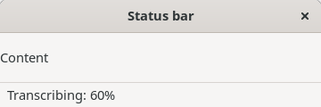
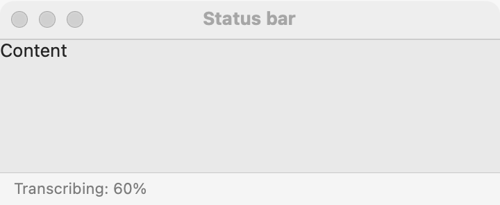
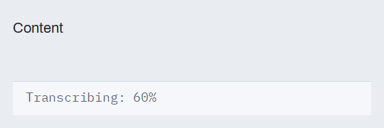

# Status bar

`GUI_STATUS_BAR` is one line of text at the bottom of a window, for messages about what the program is doing or what it just did. It is not placed in a stack: the window places it, with `GUI_WINDOW.set_status_bar`, where each platform expects it. For messages the user must act on, use a [dialog](dialogs.md); for a task's progress, add a [progress bar](progress-bar.md) to the window's content.

## Example

```eiffel
class EDITOR create make
feature
	app: GUI_APPLICATION
	status: GUI_STATUS_BAR

	make
		local
			l_window: GUI_WINDOW
			l_stack: GUI_STACK
			l_save: GUI_BUTTON
			l_area: GUI_TEXT_AREA
		do
			create app.make ("Editor", "org.example.editor")
			create l_window.make ("Editor", 420, 260)
			create l_stack.make_vertical
			create l_area.make
			l_area.set_accessible_label ("Text")
			create status.make
			status.set_text ("Ready")
			create l_save.make ("Save")
			l_save.click_actions.extend (agent save)
			l_stack.extend_stretching (l_area)
			l_stack.extend (l_save)
			l_window.set_content (l_stack)
			l_window.set_status_bar (status)
			l_window.show
			app.run
		end

	save
		do
			status.set_text ("Saved")
		end
end
```

## Try it

A window opens with a text area, a **Save** button, and "Ready" at the bottom of the window. Press **Save** and the status line says "Saved". On macOS the line sits in the window's bottom bar; on Linux and Windows it is a strip below the content.

## API

| Feature | What it does |
|---|---|
| `make` | An empty status bar. Ensures `text` is empty. |
| `text` | The line shown. |
| `set_text (a_text)` | Shows `a_text`. Ensures `text` is `a_text`. |

`GUI_WINDOW` places it:

| Feature | What it does |
|---|---|
| `GUI_WINDOW.set_status_bar (a_bar)` | Gives the window `a_bar`. Requires the window to be open (`not is_closed`), `status_bar = Void` and `a_bar.parent = Void`. Ensures `status_bar = a_bar` and `a_bar.parent` is the window. |
| `GUI_WINDOW.status_bar` | The window's status bar, once set. |

Inherited: `set_accessible_label`, `show`, `hide` and the rest of the [common features](widget.md). The status bar takes the window's text direction.

**Events:** none. The user cannot change the status line.

**Accessibility:** the role is `status`, so a screen reader knows the line reports state. Keep messages short and complete ("Saved", "3 files copied").

## On each platform

| | Linux (GTK 4) | macOS (AppKit) | Windows (simple_widgets) |
|---|---|---|---|
| Native control | A `GtkLabel` with the status role, in a strip below the content under a separator (`GtkStatusbar` is deprecated since GTK 4.10) | A label in the window's bottom bar: the content border on the bottom edge, as Finder's windows have | `SW_STATUS_BAR`: a strip below the content; the text is its left message |
| Looks or behaves differently | Plain text, left aligned, with 8 pixels of margin at the sides and 3 above and below. | Small secondary text, 24 pixels tall; the program's content ends above the bar. The text ends in "…" when it does not fit. | Mono text on the theme's variant surface, with a hairline above. |

## Design guidance

- One status bar per window, set once: `set_status_bar` requires that the window has none yet.
- The window places the status bar and the [toolbar](toolbar.md) (`set_toolbar`); never put either in a stack. On macOS the toolbar sits in the title bar and the status line in the bottom bar.
- Report what just happened or what is happening now; do not put instructions or errors the user must read there, since users often miss it.
- Keep it to one short line: long text is cut off at the window's edge.
- A worker reports through the application's mailbox; the GUI then calls `set_text`.

## Gallery

| Linux | macOS | Windows |
|---|---|---|
|  |  |  |
