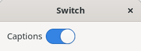
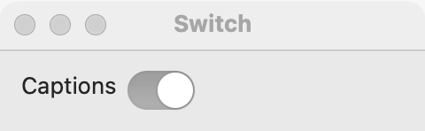
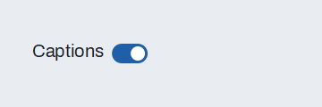

# Switch

`GUI_SWITCH` is an on/off switch. Use a switch for a setting that takes effect the moment the user flips it, such as Wi-Fi or dark mode. For a choice that is applied later (when the user presses OK or Save), or one option in a list of options, use a [check box](check-box.md). To run a command, use a [button](button.md).

## Example

```eiffel
class SWITCH_DEMO create make
feature
	app: GUI_APPLICATION
	label: GUI_LABEL

	make
		local
			l_window: GUI_WINDOW
			l_stack, l_row: GUI_STACK
			l_caption: GUI_LABEL
			l_switch: GUI_SWITCH
		do
			create app.make ("Switch demo", "org.simple-eiffel.switch-demo")
			create l_window.make ("Switch", 320, 140)
			create l_stack.make_vertical
			create l_row.make_horizontal
			create l_caption.make ("Live captions")
			create l_switch.make
			l_switch.set_accessible_label ("Live captions")
			create label.make ("Captions are off")
			l_switch.toggle_actions.extend (agent show_state)
			l_row.extend (l_caption)
			l_row.extend (l_switch)
			l_stack.extend (l_row)
			l_stack.extend (label)
			l_window.set_content (l_stack)
			l_window.show
			app.run
		end

	show_state (a_on: BOOLEAN)
		do
			if a_on then
				label.set_text ("Captions are on")
			else
				label.set_text ("Captions are off")
			end
		end
end
```

## Try it

The window shows the caption "Live captions" with a switch beside it, off, and the label "Captions are off". Flip the switch: `toggle_actions` run with `True` and the label says "Captions are on". Flip it back and they run with `False`.

## API

| Feature | What it does |
|---|---|
| `make` | Makes a switch, off. Ensures `not is_on`. |
| `is_on` | Is the switch on? |
| `set_on (a_on)` | Turns the switch on (`True`) or off (`False`), without an event. Ensures `is_on = a_on`. |
| `toggle_actions` | Agents run when the user flips the switch, with `is_on: BOOLEAN`. |

Every creation procedure requires `is_gui_thread` and `has_application`; every command requires `is_gui_thread`. See also [common features](widget.md).

**Events:** `toggle_actions` run with the new state each time the user flips the switch. `set_on` never fires `toggle_actions`; its contract ensures `toggle_actions.fire_count = old toggle_actions.fire_count`.

**Accessibility:** the role is `switch`. A switch has no caption of its own: put a [label](label.md) beside it and give the switch the same text with `set_accessible_label`. Without it, a screen reader announces an unnamed switch.

## On each platform

| | Linux (GTK 4) | macOS (AppKit) | Windows (simple_widgets) |
|---|---|---|---|
| Native control | `GtkSwitch` | `NSSwitch` | `SW_SWITCH` |
| Looks or behaves differently | Aligned to the start and centered on the row. | Assistive tools see a button with the switch subrole. | A pill track with a sliding knob, in the accent color when on. In a column it is as wide as the column, and a click anywhere along that width flips it. |

## Design guidance

- Put the caption [label](label.md) at the start of a horizontal row and the switch after it; in a right-to-left window the row mirrors.
- Always call `set_accessible_label` with the caption's text.
- Apply the setting in `toggle_actions` at once. If the change must wait for OK or Save, use a [check box](check-box.md) instead.
- Name the setting, not the action: "Live captions", not "Turn on live captions".
- Do not use a switch for a choice between two named options (Light and Dark); use a [segmented control](segmented.md) or a [radio group](radio-group.md).

## Gallery

| Linux | macOS | Windows |
|---|---|---|
|  |  |  |
