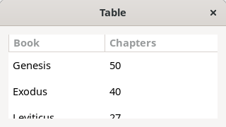
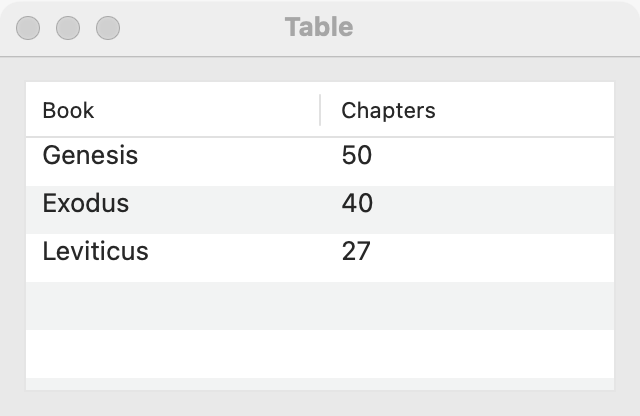
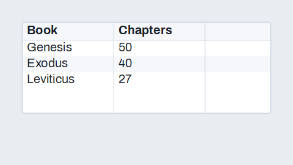
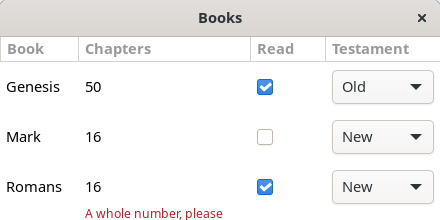
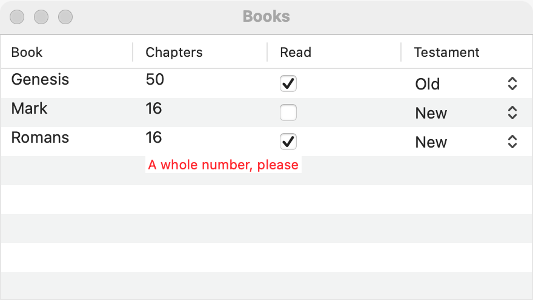
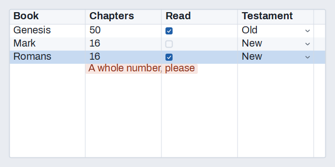

# Table

`GUI_TABLE` shows rows of text in named columns, with a header the user clicks to sort. Fill it row by row for up to a few thousand rows, or give it a row source and it asks for rows only as they come into view, so 100,000 rows cost what one screenful does. For one column of text, a [list](list.md) is simpler; for rows that nest, use a [tree table](tree-table.md).

## Example

```eiffel
class BOOK_TABLE create make
feature
	app: GUI_APPLICATION
	table: GUI_TABLE
	shown: GUI_LABEL

	make
		local
			l_window: GUI_WINDOW
			l_stack: GUI_STACK
		do
			create app.make ("Books", "org.example.book-table")
			create l_window.make ("Books", 420, 280)
			create l_stack.make_vertical
			create table.make (<<"Book", "Chapters">>)
			table.set_accessible_label ("Books")
			table.extend_row (<<"Genesis", "50">>)
			table.extend_row (<<"Exodus", "40">>)
			create shown.make ("Pick a row, or click a header.")
			table.selection_actions.extend (agent on_row)
			table.header_actions.extend (agent on_header)
			l_stack.extend_stretching (table)
			l_stack.extend (shown)
			l_window.set_content (l_stack)
			l_window.show
			app.run
		end

	on_row (a_row: INTEGER)
		do
			if a_row > 0 then
				shown.set_text (table.cell (a_row, 1) + {STRING_32} " has " + table.cell (a_row, 2) + " chapters")
			end
		end

	on_header (a_column: INTEGER; a_ascending: BOOLEAN)
		do
			shown.set_text ({STRING_32} "Sort by " + table.column_title (a_column))
		end
end
```

### Lazy rows

For many rows, or rows that are costly to make, give the table a row count and a function from a row number to its texts. The table keeps no rows itself.

```eiffel
class SQUARES create make
feature
	app: GUI_APPLICATION
	table: GUI_TABLE
	shown: GUI_LABEL

	make
		local
			l_window: GUI_WINDOW
			l_stack: GUI_STACK
		do
			create app.make ("Squares", "org.example.squares")
			create l_window.make ("Squares", 420, 320)
			create l_stack.make_vertical
			create table.make (<<"Number", "Square">>)
			table.set_accessible_label ("Squares")
			create shown.make ("Rows are made as they come into view.")
			table.set_row_source (100_000, agent square_row)
			table.selection_actions.extend (agent on_row)
			l_stack.extend_stretching (table)
			l_stack.extend (shown)
			l_window.set_content (l_stack)
			l_window.show
			app.run
		end

	square_row (a_row: INTEGER): ARRAY [READABLE_STRING_GENERAL]
		do
			Result := <<a_row.out, (a_row.to_integer_64 * a_row.to_integer_64).out>>
		end

	on_row (a_row: INTEGER)
		do
			if a_row > 0 then
				shown.set_text ("Row " + a_row.out + " of " + table.row_count.out)
			end
		end
end
```

## Try it

The first program opens a table with two columns, **Book** and **Chapters**, and two rows. Click **Exodus**: `selection_actions` fires with 2, and the line under the table says "Exodus has 40 chapters". Click the **Chapters** header: the header shows a sort indicator pointing up, and `header_actions` fires with column 2 and `True`; the line says "Sort by Chapters". Click it again and the indicator points down (`False`). The rows do not move: sorting is the program's job (see below).

The second program opens a table of 100,000 numbers and their squares. Only the rows in view, and a margin around them, are ever made; scroll to the end and the rows there are made as they appear. Select a row and the line shows its number.

## API

| Feature | What it does |
|---|---|
| `make (a_titles)` | A table with a column for each title, in order. Requires at least one title, and no empty titles. Ensures `column_count = a_titles.count` and `row_count = 0`. |
| `column_count` | How many columns there are. |
| `column_title (c)` | The title of column `c`. Requires 1 <= `c` <= `column_count`. |
| `row_count` | How many rows there are (the source's count, for a lazy table). |
| `cell (r, c)` | The text in row `r`, column `c`. Requires 1 <= `r` <= `row_count` and 1 <= `c` <= `column_count`. For a lazy table, it asks the source. |
| `extend_row (a_cells)` | Adds a row at the end, one text per column. Requires `not has_row_source` and `a_cells.count = column_count`. Ensures `row_count = old row_count + 1`. |
| `wipe_out` | Removes every row and ends lazy mode; the selection goes too, with no event. Ensures `row_count = 0`, `not has_row_source` and `selected_row = 0`. |
| `set_row_source (a_count, a_cells)` | From now on, rows 1 to `a_count` come from `a_cells`, a function from a row number to one text per column, asked for only as rows are needed. Requires `a_count >= 0`. Ensures `has_row_source`, `row_count = a_count` and `selected_row = 0`. |
| `has_row_source` | Do the rows come from a source? |
| `set_row_count (a_count)` | The source now has `a_count` rows; selected rows past it are dropped, with no event. Requires `has_row_source` and `a_count >= 0`. Ensures `row_count = a_count`. |
| `refresh_rows` | Every row may have changed (the program sorted or edited its data): the table asks again for the rows in view. The selection stays by row number; no event. Requires `has_row_source`. |
| `refresh_row (r)` | Row `r` changed: the table asks for it again if it is in view. Requires `has_row_source` and 1 <= `r` <= `row_count`. |
| `scroll_to_row (r)` | Brings row `r` into view, in any table. Requires 1 <= `r` <= `row_count`. |
| `set_multiple_selection (a_on)` | Lets the user select several rows, or only one. |
| `is_multiple_selection` | May the user select several rows? |
| `select_row (r)` | Selects only row `r`, with no event. Requires 1 <= `r` <= `row_count`. Ensures `selected_row = r` and one row selected. |
| `select_rows (a_rows)` | Selects exactly those rows, with no event. Requires `is_multiple_selection` when there is more than one, and every row in range. |
| `clear_selection` | Selects nothing. Ensures `selected_row = 0`. |
| `selected_row` | The first selected row, or 0. |
| `selected_rows` | The selected rows, in ascending order. |
| `set_sort_indicator (c, a_ascending)` | Shows the sort indicator on column `c` (0: none), pointing up when `a_ascending`. Requires 0 <= `c` <= `column_count`. |
| `sort_column` | The column whose sort indicator shows, or 0. |
| `is_sort_ascending` | Does the indicator point up? |
| `selection_actions` | `GUI_ACTIONS [TUPLE [row: INTEGER]]`: run when the user changes the selection, with the first selected row (0: none). |
| `header_actions` | `GUI_ACTIONS [TUPLE [column: INTEGER; ascending: BOOLEAN]]`: run when the user clicks a column's header, with the direction to sort in. |
| `set_row_pebble_function (a_function)` | Lets each row carry a pebble for [pick and drop](pick-and-drop.md); a drop on the table sets `last_drop_row` to the row it landed on (0: empty space). |
| `set_column_editor (c, a_kind)`, `column_editor (c)` | Lets the user edit column `c`'s cells: `Edit_text`, `Edit_check` (a check box; the text is "1" or "0") or `Edit_none` (the default). |
| `set_column_choices (c, a_choices)` | Column `c`'s cells are chosen from a dropdown of `a_choices` (`Edit_choice`). |
| `set_cell_validator (c, a_validator)` | Before an edit of column `c` is kept, `a_validator` gets the row and the new text. A message refuses it: the cell keeps its old text and shows the message under it until the next edit in the table. Void accepts it. |
| `cell_edit_actions` | `GUI_ACTIONS [TUPLE [row, column: INTEGER; text: STRING_32]]`: run after an accepted edit. A filled table already holds the new text; a lazy table's program updates its source. |
| `set_filter (a_text)`, `filter_text`, `set_filter_columns (a_columns)`, `filter_columns`, `shown_count` | Shows only the rows with a cell (in the filter's columns, or any) containing `a_text`, ignoring case. Row numbers stay the table's own; a selected row the filter hides is deselected, with the selection event. |
| `filter_with (a_search)` | Filters by a [search field](search-field.md)'s text as the user types. |
| `set_shown_rows (a_rows)` | A lazy table shows only those rows (empty: all), for a program with its own index. Requires `has_row_source`. |

Inherited: `set_accessible_label`, `set_context_menu` and the rest of the [common features](widget.md).

**Events:**
- `selection_actions` fires when the user changes the selection, with the first selected row, or 0 when none is left.
- `header_actions` fires when the user clicks a header. A new column asks for ascending; the same column again asks for the reverse. Before the agents run, the table has already moved its sort indicator there, so `sort_column` and `is_sort_ascending` match the arguments.
- `cell_edit_actions` fires after the user's accepted edit, never for a refused or cancelled one.
- `select_row`, `select_rows` and `wipe_out` fire nothing: `select_row` and `select_rows` ensure `selection_actions.fire_count = old selection_actions.fire_count`. `set_row_source`, `set_row_count`, `refresh_rows` and `set_sort_indicator` fire nothing either.

**Accessibility:** the table reads as a `tree-grid`; its rows are `row`s, its cells `grid-cell`s, and its headers `column-header`s named by their titles. Give the table `set_accessible_label` with what the rows are ("Books", "Search results"). A lazy table exposes the rows the toolkit has made views for, which are the rows near the view.

**Editing cells.** Give a column an editor and the user can change its cells:

```eiffel
books.set_column_editor (2, books.Edit_text)              -- Chapters
books.set_column_editor (3, books.Edit_check)             -- Read
books.set_column_choices (4, <<"Old", "New">>)            -- Testament
books.set_cell_validator (2, agent (r: INTEGER; t: STRING_32): detachable STRING_32
	do
		if not t.is_integer then Result := {STRING_32} "A whole number, please" end
	end)
books.cell_edit_actions.extend (agent save_cell)          -- (row, column, text)
```

A double click, F2 or Return on the selected row starts editing its first editable column; Return or leaving the cell commits and Escape cancels. A check or a choice commits as soon as it changes. A refused edit leaves the old text and a note under the cell. A lazy table holds no text of its own, so it passes accepted edits to `cell_edit_actions` and the program updates its source (then `refresh_row`).

**Filtering.** `set_filter` keeps the rows with a matching cell and `filter_with` ties it to a search field. A filled table matches in the toolkit. A lazy table filters through its row source, which may ask for every row once; with your own index, call `set_shown_rows` instead. Row numbers never change, so selections and events speak of the table's own rows, and `shown_count` says how many show.

**The program owns the order.** A header click does not reorder anything. In `header_actions`, sort your own data by that column and direction, then show it again:
- a filled table: `wipe_out`, then `extend_row` for each row in the new order;
- a lazy table: make the source answer in the new order, then `refresh_rows`.

Rows and the selection are by number, so after sorting, select again with `select_row` if the selected record should stay selected.

**Filled or lazy.** Rows added with `extend_row` are held by the table. Up to a few thousand rows that are all at hand, this is the simplest choice, and sorting by refilling is cheap. For 10,000 rows and more, or rows that cost something to make (a query, a file, a computation), use `set_row_source`: only the rows in view and a margin around them are made, and memory stays flat however many rows there are. The two modes do not mix: `extend_row` requires `not has_row_source`, and `wipe_out` ends lazy mode.

**Rules for the row source.**
- It must answer the same for a row until `set_row_count` or a `refresh_` call, and it may be asked for any row any number of times, in any order. Do not count calls.
- It answers one text per column. Missing texts show as empty cells.
- The toolkit never calls your function while drawing. It draws an unanswered row empty and asks; `GUI_TABLE` answers on the next turn of the loop, so the row appears in the next frame.
- When the data grows or shrinks, call `set_row_count`; when rows change, call `refresh_rows` or `refresh_row`.

The reasons for this design, and measurements on all three platforms, are in [Lazy tables: how they work, and why this way](../lazy-tables.md).

**A session row cache.** When rows are costly and the user scrolls back and forth, put the row cache in front of the source, so the program makes each row once in a session. It is its own library, [row_cache](../../row_cache/README.md), over a scratch file by default or SQLite as an option, and either can encrypt what it keeps:

```eiffel
create l_cache.make (3, agent make_row)      -- 3 columns, kept by row number in a scratch file
l_cache.attach (l_table, 100_000)            -- calls l_table.set_row_source for you
```

[Choosing a row store](../../row_cache/docs/choosing-a-row-store.md) says when to use the file store and when the SQL store.

## On each platform

| | Linux (GTK 4) | macOS (AppKit) | Windows (simple_widgets) |
|---|---|---|---|
| Native control | `GtkColumnView` over a `GtkStringList`, in a `GtkScrolledWindow`; columns expand and resize | `NSTableView` in a bordered `NSScrollView`; columns resize but cannot be reordered; alternating row colors | `SW_DATA_GRID`; a header click is reported, not sorted |
| Looks or behaves differently | Each column has a sorter that keeps the order, so GTK shows the indicator while the program sorts. Lazy: an unanswered row holds a one-character placeholder, and the asks are sent as one event per idle. Edited cells are `GtkEditableLabel`, `GtkCheckButton` and `GtkDropDown`; a click on a text cell starts editing, as GTK's editable labels do. A filtered table shows its own list of the matching rows. | Lazy: the table is its own data source over a bounded cache; it asks for the rows in view plus a viewful either side. Edited cells are an editable text field (a double click, or Return or F2 on the selected row; a single click only selects), a check box and a pop-up button; a refused edit's note sits under its cell. A filtered table keeps a map of the rows shown, so row numbers stay the program's. | Lazy: every unanswered row is one shared empty row; after each layout the rows in sight plus one viewful either side are checked. |

## Design guidance

- A table scrolls on its own: give it the spare room with `extend_stretching`, and never put it in a [scroll area](scroll-area.md).
- Keep column titles short, and give the table an accessible label.
- Handle `header_actions` in every table. Users expect a click on a header to sort, and the indicator moves whether or not the program sorts.
- Choose by size, not by habit: `extend_row` for what fits comfortably in memory, `set_row_source` for large or costly data, and the [row cache](../../row_cache/README.md) when making a row is slow and users scroll back.
- Right to left, the columns mirror, but column numbers stay the same: column 1 is still the first title you gave, and row and column numbers in events do not change.
- To act on several rows, turn on `set_multiple_selection (True)` and read `selected_rows` when the user presses a button.

## Gallery

| Linux | macOS | Windows |
|---|---|---|
|  |  |  |
|  |  |  |
