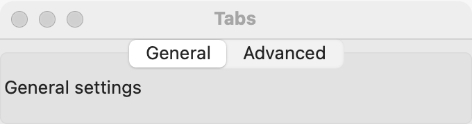

# Tabs

`GUI_TABS` shows pages one at a time, under a row of tabs the user clicks to switch pages. Use it for settings or documents that split into a few separate parts, each with a short title. When the user needs to see two parts at once, use a [splitter](splitter.md); for a few choices that change one view, use a [segmented control](segmented.md); for one optional section, use an [expander](expander.md).

## Example

```eiffel
class SETTINGS create make
feature
	app: GUI_APPLICATION
	shown: GUI_LABEL

	make
		local
			l_window: GUI_WINDOW
			l_stack: GUI_STACK
			l_tabs: GUI_TABS
		do
			create app.make ("Settings", "org.example.settings")
			create l_window.make ("Settings", 420, 260)
			create l_stack.make_vertical
			create l_tabs.make
			create shown.make ("Page 1 is shown.")
			l_tabs.extend (create {GUI_CHECK_BOX}.make ("Open the last file at start"), "General")
			l_tabs.extend (create {GUI_CHECK_BOX}.make ("Use a dark editor"), "Appearance")
			l_tabs.extend (create {GUI_CHECK_BOX}.make ("Check for updates"), "Updates")
			l_tabs.page_changed_actions.extend (agent on_page)
			l_stack.extend_stretching (l_tabs)
			l_stack.extend (shown)
			l_window.set_content (l_stack)
			l_window.show
			app.run
		end

	on_page (a_page: INTEGER)
		do
			shown.set_text ("Page " + a_page.out + " is shown.")
		end
end
```

## Try it

A window opens with three tabs, **General**, **Appearance** and **Updates**, with the first page shown, and the line "Page 1 is shown." under them. The first page added is shown without an event. Click **Updates**: `page_changed_actions` fires with 3, and the line says "Page 3 is shown."

## API

| Feature | What it does |
|---|---|
| `make` | Tabs with no pages yet. Ensures `count = 0`. |
| `extend (a_page, a_title)` | Adds `a_page` as the last page, under a tab titled `a_title`. Requires `a_page.parent = Void`, `a_page /= Current` and a non-empty `a_title`. The first page added is shown: ensures `old count = 0 implies selected_index = 1`. |
| `select_page (i)` | Shows page `i`, with no event. Requires 1 <= `i` <= `count`. Ensures `selected_index = i`. |
| `selected_index` | The page shown, or 0 when there are no pages. |
| `page_title (i)` | The title on tab `i`. Requires 1 <= `i` <= `count`. |
| `set_page_title (i, a_title)` | Retitles tab `i`, for example when the language changes. Requires 1 <= `i` <= `count` and a non-empty `a_title`. |
| `page_changed_actions` | `GUI_ACTIONS [TUPLE [page: INTEGER]]`: run when the user chooses another page. |
| `children`, `count`, `has (a_widget)` | The pages, in order (from `GUI_CONTAINER`). |

Inherited: `set_base_direction`, `set_tooltip` and the rest of the [common features](widget.md).

**Events:** `page_changed_actions` fires with the page number when the user chooses another tab. `select_page` never fires it: its postcondition is `page_changed_actions.fire_count = old page_changed_actions.fire_count`. Adding pages fires nothing either.

**Accessibility:** the tabs are a `tab-list`, and each tab reads as `tab: <title>`. The titles name the pages, so keep them short and distinct. Each page's own controls need their labels as usual.

## On each platform

| | Linux (GTK 4) | macOS (AppKit) | Windows (simple_widgets) |
|---|---|---|---|
| Native control | `GtkNotebook`, scrollable when the tabs do not fit | `NSTabView`; each page sits in a holder view the tab view sizes | `SW_TABS`: a drawn tab bar over one page |
| Looks or behaves differently | The notebook is as large as its largest page needs. Under right to left GTK mirrors the tabs itself. | The tab view is held at least as large as its largest page needs. Under right to left the backend keeps the tabs in reverse order itself, since `NSTabView` follows only the application's language. | The height follows the selected page. When the tabs do not fit, the strip scrolls with a chevron. The bar mirrors under right to left. |

## Design guidance

- Give the tabs the spare room (`extend_stretching`, or make them the window's content): the pages need it.
- Keep titles to one or two words. Retitle them with `set_page_title` when the language changes; the page numbers stay the same.
- Pages are numbered 1, 2, 3 in the order added, whatever the direction. Right to left, the first tab is at the right, and `selected_index` and the event still count from the first page added.
- Do not use tabs for steps the user must take in order; nothing stops the user from jumping ahead.
- Put each page's controls in a [stack](stack.md) or [grid](grid.md) of their own, so the page has margins.

## Gallery

| Linux | macOS | Windows |
|---|---|---|
| <!-- PROD: Linux picture --> |  | <!-- PROD: Windows picture --> |
