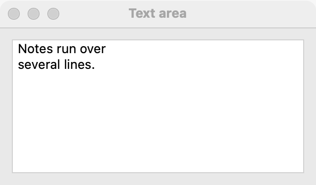

# Text area

`GUI_TEXT_AREA` is a box of plain text over several lines, which scrolls and wraps. Use it for notes, messages and results. Made read-only, it shows output the user can still select and copy. For one line, use a [text field](text-field.md); for a short message the user only reads, use a [label](label.md).

## Example

```eiffel
class TEXT_AREA_DEMO create make
feature
	app: GUI_APPLICATION
	area: GUI_TEXT_AREA
	label: GUI_LABEL

	make
		local
			l_window: GUI_WINDOW
			l_stack: GUI_STACK
		do
			create app.make ("Text area demo", "org.simple-eiffel.text-area-demo")
			create l_window.make ("Text area", 420, 300)
			create l_stack.make_vertical
			create area.make
			area.set_accessible_label ("Notes")
			create label.make ("0 characters")
			area.change_actions.extend (agent count_characters)
			l_stack.extend_stretching (area)
			l_stack.extend (label)
			l_window.set_content (l_stack)
			l_window.show
			app.run
		end

	count_characters
		do
			label.set_text (area.text.count.out + " characters")
		end
end
```

## Try it

The window shows an empty text area that takes the spare height, with "0 characters" below it. Type a few lines: after each edit `change_actions` run and the label shows the new count. Long lines wrap; when the text is taller than the box, it scrolls.

## API

| Feature | What it does |
|---|---|
| `make` | Makes an empty, editable text area. Ensures `text.is_empty` and `not is_read_only`. |
| `text` | The whole text, lines separated by new-line characters. |
| `set_text (a_text)` | Replaces the text, without a change event. Ensures `text` is `a_text`. |
| `is_read_only` | Is the user kept from editing? |
| `set_read_only (a_on)` | Stops (`True`) or allows (`False`) the user's edits. The text can still be selected and copied. |
| `change_actions` | Agents run after each user edit. |
| `change_count` | How many change events the area has received. |

Every creation procedure requires `is_gui_thread` and `has_application`; every command requires `is_gui_thread`. See also [common features](widget.md).

**Events:** `change_actions` run, with no arguments, after each edit the user makes. `set_text` never fires `change_actions`; its contract ensures `change_count = old change_count`.

**Accessibility:** the role is `text-box`. Give the area `set_accessible_label`; it has no visible text that names it.

## On each platform

| | Linux (GTK 4) | macOS (AppKit) | Windows (simple_widgets) |
|---|---|---|---|
| Native control | `GtkTextView` in a framed `GtkScrolledWindow` | `NSTextView` in a bordered `NSScrollView` | `SW_TEXT_BOX`, multi-line |
| Looks or behaves differently | Wraps at words, or inside a word too long for the line. At least 80 pixels tall. Read-only also hides the text cursor. | Plain text, with undo; no curly quotes or dash substitution. Asks for at least 64 pixels of height, weakly, so a stack can give it more. | — <!-- PROD: confirm --> |

## Design guidance

- Add a text area with `GUI_STACK.extend_stretching` in a vertical stack so it takes the spare height.
- Put a [label](label.md) above it and give the area `set_accessible_label` with the same words.
- For results, logs and transcripts, use `set_read_only (True)` and `set_text`; the user can still select and copy.
- A text area holds plain text only. For bold, italic or colored text, use a rich text area (`GUI_RICH_TEXT_AREA`).
- Do not use `change_actions` for slow work on every keystroke; act on a button or after the user pauses.

## Gallery

| Linux | macOS | Windows |
|---|---|---|
| <!-- PROD: Linux picture --> |  | <!-- PROD: Windows picture --> |
