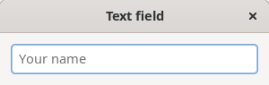
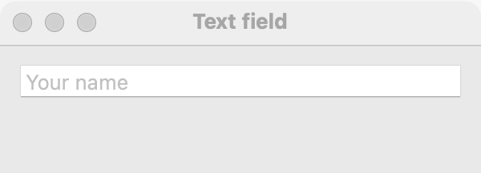
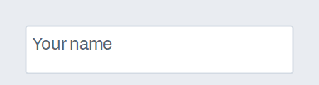

# Text field

`GUI_TEXT_FIELD` is a one-line box the user types text into. Use it for names, numbers, paths and other short entries. For more than one line, use a [text area](text-area.md). For searching, use a [search field](search-field.md). When the user picks from known values but may also type a new one, use a [combo box](combo-box.md).

## Example

```eiffel
class TEXT_FIELD_DEMO create make
feature
	app: GUI_APPLICATION
	field: GUI_TEXT_FIELD
	label: GUI_LABEL

	make
		local
			l_window: GUI_WINDOW
			l_stack: GUI_STACK
		do
			create app.make ("Text field demo", "org.simple-eiffel.text-field-demo")
			create l_window.make ("Text field", 360, 140)
			create l_stack.make_vertical
			create field.make
			field.set_accessible_label ("Name")
			field.set_placeholder ("Your name")
			create label.make ("Type your name and press Enter")
			field.change_actions.extend (agent echo)
			field.activate_actions.extend (agent greet)
			l_stack.extend (field)
			l_stack.extend (label)
			l_window.set_content (l_stack)
			l_window.show
			app.run
		end

	echo
		do
			label.set_text ({STRING_32} "Typing: " + field.text)
		end

	greet
		do
			label.set_text ({STRING_32} "Hello, " + field.text)
		end
end
```

## Try it

The window shows an empty field with the gray hint "Your name". As you type, `change_actions` run after each edit and the label echoes "Typing: …". Press Enter: `activate_actions` run and the label says "Hello, …".

## API

| Feature | What it does |
|---|---|
| `make` | Makes an empty field. Ensures `text.is_empty`. |
| `text` | The text in the field. |
| `set_text (a_text)` | Replaces the text, without a change event. Ensures `text` is `a_text`. |
| `placeholder` | The hint shown while the field is empty. |
| `set_placeholder (a_text)` | Sets the hint. |
| `set_numeric` | Marks the field as holding numbers or expressions: always left to right (`base_direction = Direction_left_to_right`). |
| `change_actions` | Agents run after each user edit. |
| `activate_actions` | Agents run when the user presses Enter. |
| `change_count` | How many change events the field has received. |
| `set_validation (a_kind)`, `set_validator (a_check)`, `set_validate_live (a_on)`, `validate`, `is_valid`, `validation_message`, `validation_actions` | Check the text and show what is wrong. See [Validation and suggestions](validation-and-suggestions.md). |
| `set_suggestions (a_choices)`, `set_suggester (a_suggester)`, `suggestions` | Suggest completions in a list under the field as the user types. See [Validation and suggestions](validation-and-suggestions.md). |

Every creation procedure requires `is_gui_thread` and `has_application`; every command requires `is_gui_thread`. See also [common features](widget.md).

**Events:** `change_actions` run, with no arguments, after each edit the user makes (each keystroke, paste or cut). `activate_actions` run, with no arguments, when the user presses Enter (keypad Enter counts as Return on every platform). `set_text` never fires `change_actions`; its contract ensures `change_count = old change_count`.

**Validation and suggestions.** A field can check its text against a kind (required, email, web address, phone, number) or your own rule, show the platform's error look with a message under the field, and offer suggestions as the user types. Checks run on Enter, on leaving the field, or on every edit if you turn that on. All of it is on the [Validation and suggestions](validation-and-suggestions.md) page. For a field that hides its characters, see the [password field](password-field.md); for a path with a **Choose...** button, the [file field](file-field.md). A field can also take files and text dropped from other programs: see [Drag and drop between programs](drag-and-drop-between-programs.md).

**Accessibility:** the role is `text-box`. A field has no visible text of its own, so give it `set_accessible_label`. The placeholder is not a label: it disappears as soon as the user types, and screen readers do not use it as the name.

## On each platform

| | Linux (GTK 4) | macOS (AppKit) | Windows (simple_widgets) |
|---|---|---|---|
| Native control | `GtkEntry` | `NSTextField` | `SW_TEXT_BOX`, single line |
| Looks or behaves differently | — | — | — |

## Design guidance

- Put a [label](label.md) before the field (above it, or at the start of a row) and give the field `set_accessible_label` with the same words.
- Use the placeholder for an example ("name@example.com"), never as the only label.
- In a horizontal row, add a field with `GUI_STACK.extend_stretching` so it takes the spare width; a short entry (a postal code) can keep its natural width.
- Call `set_numeric` on fields for numbers and expressions so a right-to-left window does not move the minus sign.
- Use `activate_actions` for "Enter submits"; do not run expensive work on every `change_actions`.

## Gallery

| Linux | macOS | Windows |
|---|---|---|
|  |  |  |
