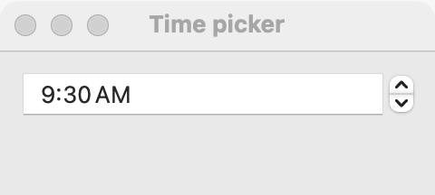

# Time picker

`GUI_TIME_PICKER` is a time of day in hours and minutes, which the user types or steps. Use it for an alarm, a meeting start, or any clock time. For a date, use a [date picker](date-picker.md) or a [calendar](calendar.md); for a duration or any other whole number, use a [spin box](spin-box.md).

## Example

```eiffel
class ALARM create make
feature
	app: GUI_APPLICATION
	shown: GUI_LABEL

	make
		local
			l_window: GUI_WINDOW
			l_stack: GUI_STACK
			l_picker: GUI_TIME_PICKER
		do
			create app.make ("Alarm", "org.example.alarm")
			create l_window.make ("Alarm", 300, 140)
			create l_stack.make_vertical
			create shown.make ("No alarm set.")
			create l_picker.make
			l_picker.set_accessible_label ("Alarm time")
			l_picker.set_time (7, 30)
			l_picker.change_actions.extend (agent on_time)
			l_stack.extend (l_picker)
			l_stack.extend (shown)
			l_window.set_content (l_stack)
			l_window.show
			app.run
		end

	on_time (a_hour, a_minute: INTEGER)
		do
			shown.set_text ("Alarm at " + a_hour.out + ":" + (a_minute + 100).out.substring (2, 3))
		end
end
```

## Try it

A window opens with a time picker showing 07:30 and the line "No alarm set." `set_time` fires no event, so the line does not change. Change the hour or the minute and `change_actions` fires: the line shows "Alarm at 7:45" (the minutes always have two digits).

## API

| Feature | What it does |
|---|---|
| `make` | A picker showing the current time. <!-- PROD: GTK and Windows start at 00:00 (sg_time_picker (0, 0), SW_TIME_PICKER set_time (0, 0)); macOS starts at the current time --> |
| `hour` | The hour shown, 0 to 23. |
| `minute` | The minute shown, 0 to 59. |
| `set_time (a_hour, a_minute)` | Shows that time, with no event. Requires 0 <= `a_hour` <= 23 and 0 <= `a_minute` <= 59. Ensures `hour = a_hour` and `minute = a_minute`. |
| `change_actions` | `GUI_ACTIONS [TUPLE [hour, minute: INTEGER]]`: run when the user commits another time. |

Inherited: `set_accessible_label`, `set_tooltip`, `enable`, `disable` and the rest of the [common features](widget.md).

**Events:** `change_actions` fires with the hour and minute when the user commits a different time. `set_time` never fires it: its postcondition is `change_actions.fire_count = old change_actions.fire_count`.

**Accessibility:** the role is `spin-button`, and a screen reader reads the value as ISO 8601 (17:05). Nothing on the picker names it, so give it `set_accessible_label` ("Alarm time", "Start"). <!-- PROD: confirm the role on GTK, where the picker is a group of two spin buttons named "Hour" and "Minute" -->

## On each platform

| | Linux (GTK 4) | macOS (AppKit) | Windows (simple_widgets) |
|---|---|---|---|
| Native control | Two `GtkSpinButton`s, hour and minute, with a colon between them | `NSDatePicker`, text field and stepper style, hours and minutes | `SW_TIME_PICKER`: a time field |
| Looks or behaves differently | Each part shows two digits and wraps (59 steps to 00). Each step is a change. | The user types or steps each part; the time follows the local time zone. | 24-hour locales show HH:MM, 12-hour locales H:MM AM/PM; either is accepted when typed. A time that cannot be read is tinted as invalid. |

## Design guidance

- Put the picker at its natural width beside a caption that says what the time is for; in a form, use a [grid](grid.md).
- Give it an accessible label: a caption beside it is a separate widget, and the picker has no text of its own.
- Hours are 0 to 23 in the API on every platform, whatever the locale shows. Convert in the program if you display times elsewhere.
- Set the time you want shown with `set_time` right after `make`, so every platform starts the same.
- A time picker has no date. Pair it with a [date picker](date-picker.md) when the user needs both.

## Gallery

| Linux | macOS | Windows |
|---|---|---|
| <!-- PROD: Linux picture --> |  | <!-- PROD: Windows picture --> |
