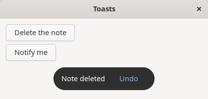
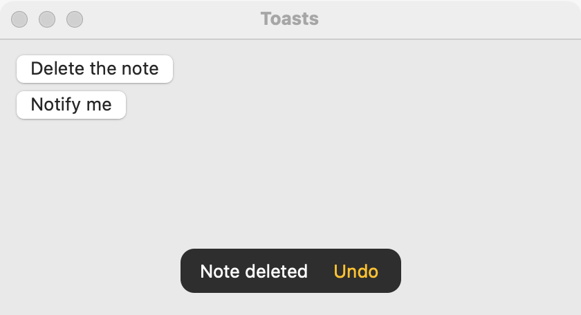
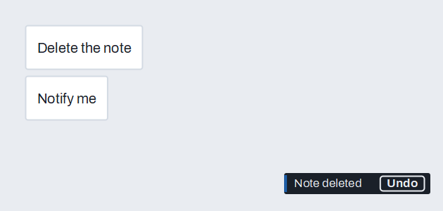

# Toasts and notifications

simple_gui has two ways to tell the user something short without stopping them. A **toast** is a small message at the bottom of one of the program's windows that closes by itself, optionally with one action such as "Undo". A **desktop notification** appears outside the program's windows, in the system's own notification place, so it can reach a user who is looking at another program. Toasts are on `GUI_WINDOW`; notifications are on `GUI_APPLICATION`.

Use a toast to confirm something the user just did ("Note deleted") or to offer an undo. Use a notification for something that happens while the user is elsewhere (a long job is done). For a message that stays until dealt with, use an [info bar](info-bar.md); for one the user must answer, use a [dialog](dialogs.md).

## Example

```eiffel
class TOAST_DEMO create make
feature
	app: GUI_APPLICATION
	window: GUI_WINDOW
	status: GUI_LABEL

	make
		local
			l_stack: GUI_STACK
			l_delete, l_notify: GUI_BUTTON
		do
			create app.make ("Toast demo", "org.simple-eiffel.toast-demo")
			create window.make ("Toasts", 420, 200)
			create l_stack.make_vertical
			create l_delete.make ("Delete the note")
			l_delete.click_actions.extend (agent delete_note)
			create l_notify.make ("Notify me")
			l_notify.click_actions.extend (agent send_notice)
			create status.make ("The note is here.")
			l_stack.extend (l_delete)
			l_stack.extend (l_notify)
			l_stack.extend (status)
			window.set_content (l_stack)
			window.show
			app.run
		end

	delete_note
		do
			status.set_text ("The note is gone.")
			window.show_toast_with_action ("Note deleted", "Undo", agent undo_delete)
		end

	undo_delete
		do
			status.set_text ("The note is back.")
			window.show_toast ("Note restored")
		end

	send_notice
		do
			app.notify_with_action ("Toast demo", "The job is done.", agent notice_clicked)
		end

	notice_clicked
		do
			status.set_text ("You clicked the notification.")
			window.show_toast ("Welcome back")
		end
end
```

## Try it

Press **Delete the note**. The line says "The note is gone." and a toast reading "Note deleted" with an **Undo** button appears at the bottom of the window. Press **Undo**: the line says "The note is back." and a plain toast reads "Note restored". Leave the first toast alone and it closes by itself after about 8 seconds; the plain one closes after about 4 seconds. Press **Notify me**: the system shows a notification titled "Toast demo" reading "The job is done." Click it, and the line says "You clicked the notification."

## API: toasts, on `GUI_WINDOW`

| Feature | What it does |
|---|---|
| `show_toast (a_message)` | Shows `a_message` at the bottom of the window. It closes by itself after about 4 seconds. Requires `is_gui_thread`, `not is_closed` and a non-empty `a_message`. Ensures `last_toast` is `a_message`. |
| `show_toast_with_action (a_message, an_action_text, an_action)` | Shows `a_message` with one button, `an_action_text` ("Undo"). It lives about 8 seconds. If the user presses the button, `an_action` runs, once, on the GUI processor. Requires `is_gui_thread`, `not is_closed`, and a non-empty `a_message` and `an_action_text`. Ensures `last_toast` is `a_message`. |
| `last_toast` | The message of the toast shown most recently; empty before the first. Meant for tests. |

On Linux, showing a toast while another is up replaces the first.

## API: notifications, on `GUI_APPLICATION`

| Feature | What it does |
|---|---|
| `notify (a_title, a_body)` | Shows a desktop notification, outside the program's windows. Requires `is_gui_thread` and a non-empty `a_title`. |
| `notify_with_action (a_title, a_body, an_action)` | The same, and `an_action` runs, on the GUI processor, if the user clicks the notification. Requires `is_gui_thread` and a non-empty `a_title`. |
| `last_notification` | The title and body of the notification sent most recently, as the title, a new line, and the body. Empty before the first. Meant for tests. |

See [Window](window.md) for the rest of `GUI_WINDOW`.

**Events:** a toast's action runs `an_action` once. A second press on the same action does nothing. A toast that closes by itself fires nothing. `show_toast` and `notify` themselves fire nothing, and the program is not told that a notification was ignored or dismissed.

**Accessibility:** a toast is gone in seconds, so never put the only copy of an important fact in one, and name its action with a word that makes sense alone ("Undo"). Write texts as short sentences ("Note deleted").

## On each platform

| | Linux (GTK 4) | macOS (AppKit) | Windows (simple_widgets) |
|---|---|---|---|
| Toast | A label and a flat button in a box in the window's overlay, at the bottom center, closed by a GLib timeout. | An overlay view in the window. | `SW_WINDOW.toast` and `toast_with_action`. |
| Notification | `org.freedesktop.Notifications` over D-Bus, with no extra library; the program listens for the server's `ActionInvoked` signal to run the action. | `UNUserNotificationCenter`. | A balloon from the program's notification-area icon, made by simple_shell's `SHELL_TRAY`. A click on the balloon runs the action. |
| Looks or behaves differently | If the program cannot reach the D-Bus session bus, `notify` shows nothing and raises nothing. | The same overlay view carries the action. | The icon is made at the first notice; the balloon's title and body are shortened to the limits `SHELL_TRAY` sets. If the icon cannot be installed, nothing shows. |

The macOS column follows the design for that platform; the AppKit side is still to be written.

## Testing

A test cannot click a desktop notification: it belongs to the system, not to the program's windows. That is why `last_notification` exists. A test calls `app.notify ("simple_gui", "A test notification")` and checks that `last_notification` reads "simple_gui", a new line, and "A test notification". The same applies to `last_toast` for the text of a toast. A test can press a toast's action with the shared `GUI_TEST_DRIVER` (`toast_shown` and `press_toast`); two presses run the action once.

## Design guidance

- Keep a toast to a few words, and put in it only what is also true a moment later. It is gone in seconds.
- Offer "Undo" in a toast after something the user can take back, rather than asking "Are you sure?" first.
- Use a notification only for events the user wants to hear about while elsewhere. Never use it for what the user just did, and never repeat one.
- Give a notification a clear title (the program's name or the event) and a body with the detail.
- Do not rely on a notification arriving: the user may have turned them off, or the system may have no service. Show the result in the window as well.
- Say plainly in the text what clicking does, if the click does anything.

## Gallery

| Linux | macOS | Windows |
|---|---|---|
|  |  |  |
