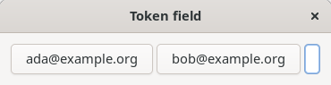
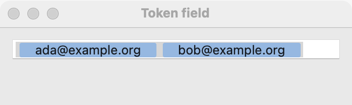
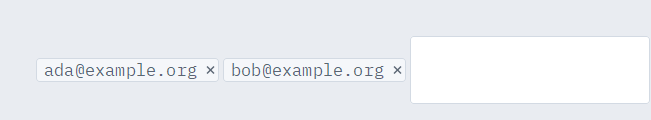

# Token field

`GUI_TOKEN_FIELD` is a text field whose entries become tokens, or chips, as the user types: recipients of a message, tags on a note. Use it when the value is a list of short items the user types freely. For one line of text, use a [text field](text-field.md); to pick items from a fixed set, use a [list](list.md) or [check boxes](check-box.md).

## Example

```eiffel
class
	TAGGER

create
	make

feature {NONE} -- Initialization

	make
		local
			l_window: GUI_WINDOW
			l_stack: GUI_STACK
		do
			create app.make ("Tagger", "org.example.tagger")
			create l_window.make ("Tagger", 400, 140)
			create l_stack.make_vertical
			create tags.make
			tags.set_accessible_label ("Tags")
			tags.extend_token ("draft")
			create status.make ("1 tag")
			tags.change_actions.extend (agent show_count)
			l_stack.extend (tags)
			l_stack.extend (status)
			l_window.set_content (l_stack)
			l_window.show
			app.run
		end

feature -- Access

	app: GUI_APPLICATION

	tags: GUI_TOKEN_FIELD

	status: GUI_LABEL

feature {NONE} -- Events

	show_count
		do
			status.set_text (tags.count.out + " tags")
		end

end
```

## Try it

The field shows one token, "draft", and the label reads "1 tag". Type `work, urgent` and press Return: each comma and the Return make a token, `change_actions` fire, and the label reads "3 tags". Remove a token: on macOS select it and press Delete; on Linux press Backspace in the empty entry, which removes the last token; on Windows click the chip's remove button. `change_actions` fire again and the count goes down.

## API

| Feature | What it does |
|---|---|
| `make` | An empty token field. Needs the application. Afterward `count` is 0. |
| `count` | How many tokens there are. |
| `i_th (i)` | Token `i`'s text; `1 <= i` and `i <= count`. |
| `tokens` | Every token, in order, as a new list of `count` strings. |
| `extend_token (a_text)` | Add a token at the end. `a_text` is not empty. Fires nothing. |
| `remove_token (i)` | Remove token `i`; `1 <= i` and `i <= count`. Fires nothing. |
| `wipe_out` | Remove every token. Fires nothing. |
| `change_actions` | Agents run when the user adds or removes tokens. |

The rest are the [common features](widget.md).

**Events:** `change_actions` fire, with no arguments, when the user's typing or deleting changes the list of tokens. Read `tokens` in the agent. `extend_token`, `remove_token` and `wipe_out` never fire them.

**Accessibility:** the field's role is `text-box`, and each token is a `button` named by its text. The field has no visible label of its own: give it `set_accessible_label` ("To", "Tags"), and put a [label](label.md) beside it.

## On each platform

| | Linux (GTK 4) | macOS (AppKit) | Windows (simple_widgets) |
|---|---|---|---|
| Native control | a `GtkBox` of pill `GtkButton`s and a `GtkEntry` | `NSTokenField`, rounded tokens | `GUI_SW_TOKEN_FIELD`, an `SW_ROW` of `SW_CHIP`s and an `SW_TEXT_BOX` |
| Looks or behaves differently | Backspace in the empty entry removes the last token. | A comma or Return makes a token. Empty tokens are dropped. | Each chip has its own remove button. |

## Design guidance

- Put a label before it ("To:", "Tags:") and let it take the window's width, with `extend_stretching` in a horizontal stack or a stretching grid column.
- Keep tokens short: names, addresses, single words.
- Check each token in `change_actions` (an address that is not valid, a duplicate tag) and say so in a label; do not remove the user's tokens silently.
- Use `extend_token` to fill the field from saved data; it fires nothing, so the program does not hear its own changes.

## Gallery

| Linux | macOS | Windows |
|---|---|---|
|  |  |  |
