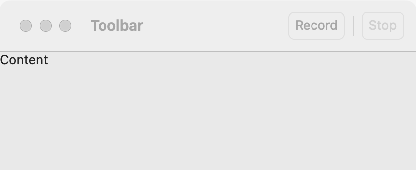

# Toolbar

`GUI_TOOLBAR` is a row of buttons that the window places where each platform expects a toolbar. Use it for the few commands people use most, each of which is also in a [menu](menus.md). For a command that belongs to one part of the window, put a [button](button.md) next to that part; for a set of related commands behind one button, use a [menu button](menu-button.md).

## Example

```eiffel
class
	COUNTER

create
	make

feature {NONE} -- Initialization

	make
		local
			l_window: GUI_WINDOW
			l_toolbar: GUI_TOOLBAR
			l_add, l_reset: GUI_BUTTON
		do
			create app.make ("Counter", "org.example.counter")
			create l_window.make ("Counter", 360, 160)
			create l_toolbar.make
			create l_add.make ("Add One")
			create l_reset.make ("Reset")
			l_toolbar.extend (l_add)
			l_toolbar.add_separator
			l_toolbar.extend (l_reset)
			create total.make ("0")
			l_add.click_actions.extend (agent add_one)
			l_reset.click_actions.extend (agent reset)
			l_window.set_toolbar (l_toolbar)
			l_window.set_content (total)
			l_window.show
			app.run
		end

feature -- Access

	app: GUI_APPLICATION

	total: GUI_LABEL

	count: INTEGER

feature {NONE} -- Events

	add_one
		do
			count := count + 1
			total.set_text (count.out)
		end

	reset
		do
			count := 0
			total.set_text ("0")
		end

end
```

## Try it

The window shows **Add One** and **Reset** in its toolbar, with a thin line between them, and a label reading "0". Click **Add One**: that button's `click_actions` fire and the label counts up. Click **Reset** and it goes back to 0. On macOS the toolbar is in the title bar; on Linux and Windows it is a strip above the content.

## API

| Feature | What it does |
|---|---|
| `make` | An empty toolbar. Needs the application. |
| `extend (a_button)` | Add `a_button`, a `GUI_BUTTON`, at the end. `a_button` must have no parent; afterward its parent is the toolbar. |
| `add_separator` | A gap between groups of buttons. It is not a child: `count` stays the same and `separator_count` goes up by one. |
| `count` | How many buttons the toolbar has (separators do not count). |
| `children` | The buttons, in order. |
| `has (a_widget)` | Is `a_widget` one of the buttons? |
| `separator_count` | How many separators were added. |
| `GUI_WINDOW.set_toolbar (a_toolbar)` | Put the toolbar in the window. The window must be open and have no toolbar yet; the toolbar must have no parent. |

The buttons are ordinary [buttons](button.md): `enable`, `disable`, `set_text` and `click_actions` work as anywhere else. `hide` and `show` on the toolbar hide and show it. The rest are the [common features](widget.md).

**Events:** the toolbar has none of its own. Each button fires its `click_actions` when the user clicks it, never when code changes it.

**Accessibility:** the toolbar's role is `toolbar`, and each button is a `button`, named by its text. Give each button a short text that names its command, and a tooltip with `set_tooltip` if the text alone is not clear.

## On each platform

| | Linux (GTK 4) | macOS (AppKit) | Windows (simple_widgets) |
|---|---|---|---|
| Native control | a horizontal `GtkBox` with the `toolbar` style class, above the content | an `NSToolbar` in the title bar; each button is the view of an `NSToolbarItem` | a row of real buttons above the content, known to screen readers as a toolbar |
| Separator | a vertical `GtkSeparator` | a thin line item (NSToolbar has drawn no separator of its own since macOS 11), left out of the accessibility tree | — <!-- PROD: confirm --> |
| Looks or behaves differently | | Users cannot customize it. When the window is narrow, items move to the overflow menu. The toolbar adds to the title bar, so the content keeps the size the program asked for. | |

## Design guidance

- Keep it short: a handful of buttons, in the order people use them, with separators between groups.
- Put every toolbar command in a menu too. On macOS a narrow window moves items to the overflow menu, and a menu is where keyboard users look first.
- Use short button texts ("Add", "Share"), not sentences. Icons are not supported yet.
- Disable a button whose command cannot run now, rather than hiding it, so the toolbar does not jump.
- The toolbar mirrors in a right-to-left window: it takes the window's direction through `set_toolbar`.

## Gallery

| Linux | macOS | Windows |
|---|---|---|
| <!-- PROD: Linux picture --> |  | <!-- PROD: Windows picture --> |
