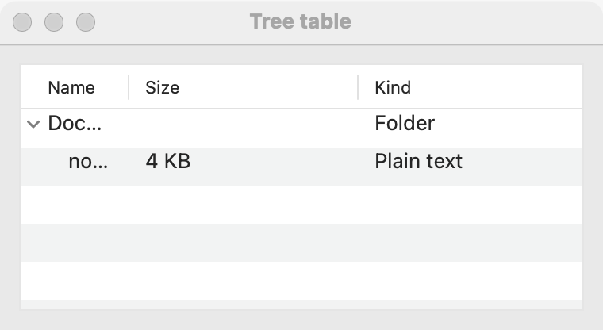

# Tree table

`GUI_TREE_TABLE` is a [tree](tree.md) with titled columns: each node has its text in column 1 and more cells beside it. Use it for a hierarchy where each item has details, such as files with sizes and dates, or books with chapter counts. For a hierarchy of names alone, a [tree](tree.md) is simpler; for flat rows, use a [table](table.md).

## Example

```eiffel
class CANON_TABLE create make
feature
	app: GUI_APPLICATION
	books: GUI_TREE_TABLE
	shown: GUI_LABEL

	make
		local
			l_window: GUI_WINDOW
			l_stack: GUI_STACK
			l_law: INTEGER
		do
			create app.make ("Canon", "org.example.canon-table")
			create l_window.make ("Canon", 400, 300)
			create l_stack.make_vertical
			create books.make (<<"Book", "Chapters">>)
			books.set_accessible_label ("Books")
			books.add_root ("Law")
			l_law := books.last_node
			books.add_child (l_law, "Genesis")
			books.set_cell (books.last_node, 2, "50")
			books.add_child (l_law, "Exodus")
			books.set_cell (books.last_node, 2, "40")
			books.expand (l_law)
			create shown.make ("Pick a book.")
			books.selection_actions.extend (agent on_node)
			l_stack.extend_stretching (books)
			l_stack.extend (shown)
			l_window.set_content (l_stack)
			l_window.show
			app.run
		end

	on_node (a_node: INTEGER)
		do
			if a_node > 0 then
				shown.set_text (books.cell (a_node, 1) + {STRING_32} ": " + books.cell (a_node, 2))
			end
		end
end
```

## Try it

A window opens with a header, **Book** and **Chapters**, and the node **Law** expanded to show Genesis (50) and Exodus (40). Click **Exodus**: `selection_actions` fires with node 3, and the line says "Exodus: 40". Click **Law**: its Chapters cell was never set, so the line says "Law: ".

## API

`GUI_TREE_TABLE` has every feature of [`GUI_TREE`](tree.md) (`add_root`, `add_child`, `last_node`, `node_text`, `parent_of`, `expand`, `collapse`, `select_node`, `selection_actions`, `expansion_actions` and the rest), with a different creation procedure and these additions:

| Feature | What it does |
|---|---|
| `make (a_titles)` | An empty tree table with these column titles. Requires at least one title. Ensures `node_count = 0` and `column_count = a_titles.count`. |
| `column_count` | How many columns there are. |
| `column_title (c)` | The title of column `c`. Requires 1 <= `c` <= `column_count`. |
| `cell (n, c)` | Node `n`'s text in column `c`. Column 1 is `node_text (n)`; a cell never set is empty. Requires `is_node (n)` and 1 <= `c` <= `column_count`. |
| `set_cell (n, c, a_text)` | Shows `a_text` as node `n`'s cell in column `c`. Column 1 renames the node. Requires `is_node (n)` and 1 <= `c` <= `column_count`. Ensures `cell (n, c)` is `a_text`. |

Inherited: `set_accessible_label`, `set_context_menu` and the rest of the [common features](widget.md).

**Events:** the tree's. `selection_actions` fires with the node (0: none) when the user selects one; `expansion_actions` fires with the node and whether it is now open when the user expands or collapses it. `add_root`, `add_child`, `set_cell`, `expand`, `collapse` and `select_node` fire nothing.

**Accessibility:** a tree table reads as a `tree-grid`, as a [table](table.md) does: rows are `row`s, cells `grid-cell`s, and headers `column-header`s named by their titles. Give it `set_accessible_label` with what it holds.

## On each platform

| | Linux (GTK 4) | macOS (AppKit) | Windows (simple_widgets) |
|---|---|---|---|
| Native control | `GtkColumnView` over a `GtkTreeListModel` | `NSOutlineView` with columns and a header; column 1 holds the outline | `SW_TREE_TABLE`: `SW_TREE`'s rows with `SW_DATA_GRID`'s columns |
| Looks or behaves differently | — <!-- PROD: confirm --> | Columns resize but cannot be reordered; alternating row colors. | Column 1 is the tree itself (indent, arrows, label); the header names the columns. |

## Design guidance

- Give it the spare room with `extend_stretching`; it scrolls on its own.
- Put the name of each item in column 1, and details in the others. Keep detail columns short (numbers, dates, sizes).
- Fill the cells right after `add_root` or `add_child`, using `last_node`.
- A tree table has no sort header. If users must sort, a flat [table](table.md) may serve them better.
- Column numbers in `cell` and `set_cell` follow the order of the titles you gave, whatever the window's direction. <!-- PROD: confirm the columns mirror right to left on each platform -->

## Gallery

| Linux | macOS | Windows |
|---|---|---|
| <!-- PROD: Linux picture --> |  | <!-- PROD: Windows picture --> |
