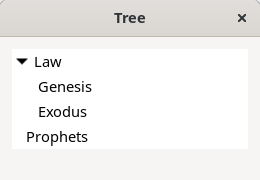
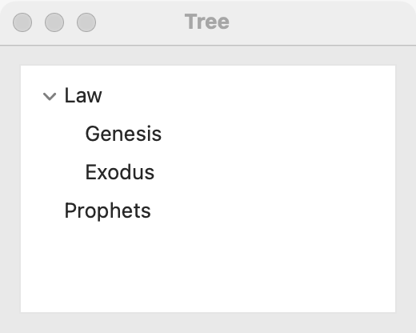
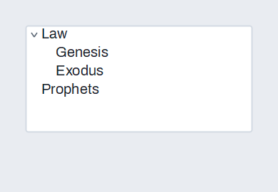

# Tree

`GUI_TREE` shows nodes of text in a hierarchy that the user expands and collapses. Use it for anything with parents and children: folders, chapters in books, an outline. When each node needs more than one column, use a [tree table](tree-table.md); for a flat set of rows, use a [list](list.md) or a [table](table.md).

## Example

```eiffel
class CANON create make
feature
	app: GUI_APPLICATION
	tree: GUI_TREE
	shown: GUI_LABEL

	make
		local
			l_window: GUI_WINDOW
			l_stack: GUI_STACK
			l_law: INTEGER
		do
			create app.make ("Canon", "org.example.canon")
			create l_window.make ("Canon", 340, 300)
			create l_stack.make_vertical
			create tree.make
			tree.set_accessible_label ("Books")
			tree.add_root ("Law")
			l_law := tree.last_node
			tree.add_child (l_law, "Genesis")
			tree.add_child (l_law, "Exodus")
			tree.add_root ("Prophets")
			tree.add_child (tree.last_node, "Isaiah")
			tree.expand (l_law)
			create shown.make ("Pick a book.")
			tree.selection_actions.extend (agent on_node)
			l_stack.extend_stretching (tree)
			l_stack.extend (shown)
			l_window.set_content (l_stack)
			l_window.show
			app.run
		end

	on_node (a_node: INTEGER)
		do
			if a_node > 0 then
				shown.set_text ({STRING_32} "You picked " + tree.node_text (a_node))
			end
		end
end
```

## Try it

A window opens with two top-level nodes, **Law** (expanded, showing Genesis and Exodus) and **Prophets** (collapsed). `expand` fires no event. Click **Exodus**: `selection_actions` fires with node 3, and the line says "You picked Exodus". Expand **Prophets** and pick **Isaiah**; expanding fires `expansion_actions`, which this example does not use.

## API

| Feature | What it does |
|---|---|
| `make` | An empty tree. Ensures `node_count = 0`. |
| `add_root (a_text)` | Adds a top-level node. Its number is `last_node`. Ensures `node_count = old node_count + 1`, `last_node = node_count` and `parent_of (last_node) = 0`. |
| `add_child (a_parent, a_text)` | Adds a node under `a_parent`. Requires `is_node (a_parent)`. Ensures `last_node = node_count` and `parent_of (last_node) = a_parent`. |
| `last_node` | The node added most recently. Nodes are numbered 1, 2, 3… in the order they are added. |
| `node_count` | How many nodes there are. |
| `is_node (n)` | Is `n` a node's number (1 <= `n` <= `node_count`)? |
| `node_text (n)` | The text of node `n`. Requires `is_node (n)`. |
| `parent_of (n)` | The node `n` was added under, or 0 for a top-level node. Requires `is_node (n)`. |
| `is_expanded (n)` | Are `n`'s children shown? Requires `is_node (n)`. |
| `expand (n)` | Shows `n`'s children, with no event. Requires `is_node (n)`. |
| `collapse (n)` | Hides `n`'s children, with no event. Requires `is_node (n)`. Ensures `not is_expanded (n)`. |
| `selected_node` | The selected node, or 0. |
| `select_node (n)` | Selects node `n` (0: none), expanding its ancestors so it can be seen; no event. Requires `n = 0` or `is_node (n)`. Ensures `selected_node = n`. |
| `selection_actions` | `GUI_ACTIONS [TUPLE [node: INTEGER]]`: run when the user selects a node (0: none). |
| `expansion_actions` | `GUI_ACTIONS [TUPLE [node: INTEGER; is_open: BOOLEAN]]`: run when the user expands or collapses a node. |

Inherited: `set_accessible_label`, `set_context_menu` and the rest of the [common features](widget.md).

**Events:**
- `selection_actions` fires with the node's number when the user selects a node, or 0 when the selection is cleared.
- `expansion_actions` fires with the node and `True` when the user expands it, `False` when the user collapses it.
- `add_root`, `add_child`, `expand`, `collapse` and `select_node` fire nothing. `expand`, `collapse` and `select_node` ensure their actions' `fire_count` is unchanged, and the ancestors that `select_node` opens fire no `expansion_actions` either.

**Accessibility:** the role is `tree`, and each shown node is a `tree-item` read by its text. Give the tree `set_accessible_label` with what it holds ("Books", "Folders").

## On each platform

| | Linux (GTK 4) | macOS (AppKit) | Windows (simple_widgets) |
|---|---|---|---|
| Native control | `GtkListView` over a `GtkTreeListModel`, in a `GtkScrolledWindow` | `NSOutlineView` with one column and no header, inset style, in a bordered `NSScrollView` | `SW_TREE`: a drawn tree over node numbers |
| Looks or behaves differently | A node with no children shows no disclosure triangle. | A node with no children shows no disclosure triangle. | Children are asked for only when a node is expanded. The arrow keys move; Left collapses, Right expands. |

## Design guidance

- A tree scrolls on its own: give it the spare room with `extend_stretching`, and never put it in a [scroll area](scroll-area.md).
- Keep your own data by node number: `last_node` after each `add_root` or `add_child` is the number events will report.
- Expand the first level from code (`expand`) when the tree is small, so the user sees more than a column of closed nodes.
- Use `select_node` to show the user a node found by a search; it opens the ancestors for you, silently.
- A node with no children has nothing to show; `expand` on it changes nothing you can see.

## Gallery

| Linux | macOS | Windows |
|---|---|---|
|  |  |  |
