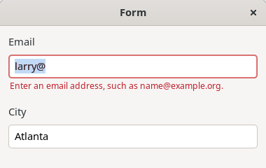
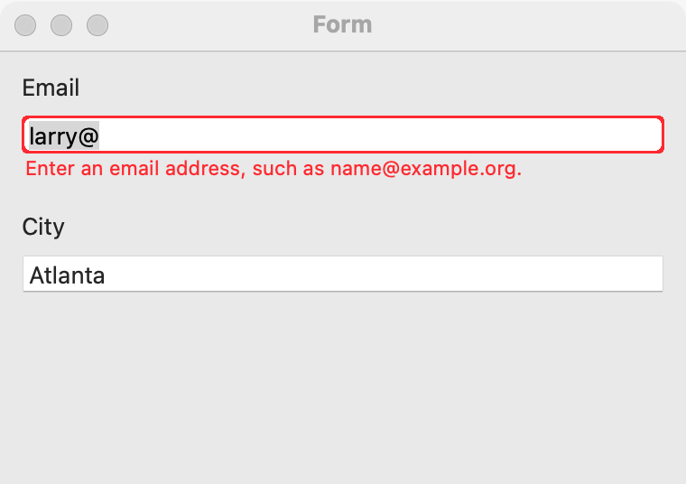
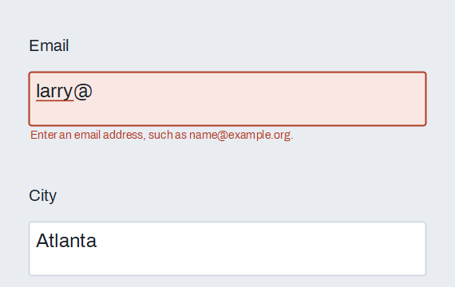

# Validation and suggestions

Every `GUI_TEXT_FIELD` (and so every [password field](password-field.md)) can check its text and show what is wrong, and can suggest completions as the user types. Use validation when a field must hold an email address, a web address, a phone number, a number or any text your program can judge; the field shows the platform's error look and a message under it. Use suggestions when the user types a value that usually comes from a known set. If the value must come from the set, use a [dropdown](dropdown.md); if it may also be new, a [combo box](combo-box.md) keeps the options in a list instead of a popup. This page adds to the [text field](text-field.md) page.

## Example

```eiffel
class FORM_DEMO create make
feature
	app: GUI_APPLICATION
	email: GUI_TEXT_FIELD
	city: GUI_TEXT_FIELD
	status: GUI_LABEL

	make
		local
			l_window: GUI_WINDOW
			l_stack: GUI_STACK
		do
			create app.make ("Form demo", "org.simple-eiffel.form-demo")
			create l_window.make ("Form", 380, 220)
			create l_stack.make_vertical
			create email.make
			email.set_accessible_label ("Email")
			email.set_validation (email.Validate_email)
			email.validation_actions.extend (agent on_validity)
			create city.make
			city.set_accessible_label ("City")
			city.set_suggestions (<<"Amsterdam", "Athens", "Austin", "Berlin">>)
			city.set_validator (agent too_short)
			create status.make ("Fill in the form.")
			l_stack.extend (email)
			l_stack.extend (city)
			l_stack.extend (status)
			l_window.set_content (l_stack)
			l_window.show
			app.run
		end

	too_short (a_text: STRING_32): detachable STRING_32
			-- A message when `a_text' is too short to be a city, else Void.
		do
			if a_text.count < 3 then
				Result := "Enter at least 3 letters."
			end
		end

	on_validity (a_is_valid: BOOLEAN)
		do
			if a_is_valid then
				status.set_text ("The email is fine.")
			else
				status.set_text ({STRING_32} "Email: " + email.validation_message)
			end
		end
end
```

## Try it

The window shows two empty fields and the line "Fill in the form." Type "not an address" in the email field: nothing is checked yet. Press Enter or move to the city field: the field takes the platform's error look, a red note under it reads "Enter an email address, such as name@example.org.", and `validation_actions` runs with `False`, so the line shows the same message. Fix the text and leave the field again: the error goes away and `validation_actions` runs with `True`. In the city field, type "a" and leave the field: the note reads "Enter at least 3 letters." Type again: a list under the field offers Amsterdam, Athens and Austin. Type "at": only Athens remains. Choose it with the pointer, or with Up, Down and Return: the field fills with "Athens" and `change_actions` runs.

## API

**Validation**

| Feature | What it does |
|---|---|
| `Validate_none`, `Validate_required`, `Validate_email`, `Validate_url`, `Validate_phone`, `Validate_number` | The kinds, numbered 0 to 5. A new field is `Validate_none` (nothing is checked until you choose a kind or a validator). |
| `set_validation (a_kind)` | Chooses the kind. Requires `Validate_none <= a_kind <= Validate_number`. Ensures `validation_kind = a_kind`. |
| `validation_kind` | The kind now. |
| `set_validator (a_check)` | Adds your own check: an agent that takes the text and answers a message, or `Void` when the text is fine. It runs only when the kind's own check found nothing wrong. `Void` removes it. Ensures `validator = a_check`. |
| `set_validate_live (a_on)` | Checks after every edit when `a_on`, instead of only when the user commits. Ensures `is_validate_live = a_on`. |
| `validate` | Checks the text now, shows the result, and runs `validation_actions` if the answer changed. Requires `is_gui_thread`. |
| `is_valid` | Was the text acceptable when last checked? True until the first check. |
| `validation_message` | Why the text was not acceptable at the last check; empty when it was. |
| `validation_actions` | `GUI_ACTIONS [TUPLE [is_valid: BOOLEAN]]`: run when a check changes whether the text is acceptable. |

What the kinds check (the text is trimmed first; an empty text is fine except for `Validate_required`):

| Kind | Accepts | Message when it fails |
|---|---|---|
| `Validate_required` | Any text that is not empty | "Required." |
| `Validate_email` | One `@` with something before it, a dotted domain after it, and no spaces | "Enter an email address, such as name@example.org." |
| `Validate_url` | `http://` or `https://`, then a host with a dot (or `localhost`), no spaces | "Enter a web address, such as https://example.org." |
| `Validate_phone` | 7 to 15 digits, with spaces, dashes, dots, brackets and a leading `+` allowed | "Enter a phone number." |
| `Validate_number` | Anything that reads as a real number | "Enter a number." |

For a rule of your own (a pattern, a range, two fields that must match), use `set_validator`.

**Suggestions**

| Feature | What it does |
|---|---|
| `set_suggestions (a_choices)` | Suggests those of `a_choices` that begin with the typed text, ignoring case, and are longer than it. Removes a suggester. |
| `set_suggester (a_suggester)` | Suggests whatever `a_suggester` answers for the typed text: an agent from the text to a list of texts. `Void` stops suggesting. Use it when the choices come from a search or a database. |
| `suggestions` | The suggestions for the text now; updated after each user edit. |

`validate` requires `is_gui_thread`, as does every creation procedure and command of a field. See also the [common features](widget.md).

**Events:** a field is checked when the user presses Enter (after `activate_actions` runs), when the user leaves the field (editing ended), and after every edit if `set_validate_live` is on. `validation_actions` runs only when the field changes between acceptable and not acceptable; a second failure with another message does not run it, but `validation_message` and the note under the field change. `validate` called from the program runs it in the same way. Suggestions are worked out after each user edit. Choosing a suggestion fills the field and runs `change_actions`, as typing would. `set_text`, `set_validation`, `set_validator`, `set_suggestions` and `set_suggester` fire nothing and do not check the text; call `validate` when you want that.

**Accessibility:** the role stays `text-box`. On Linux an invalid field is marked invalid for assistive tools and its message becomes its accessible description, so a screen reader reads the problem with the field. The message is not the label: keep `set_accessible_label` as the name of the field.

## On each platform

| | Linux (GTK 4) | macOS (AppKit) | Windows (simple_widgets) |
|---|---|---|---|
| Error look | The `error` style on the entry, and a small red note placed under it over the window's content | A red border and a small red note under the field | The control's danger look, and a note under the field drawn by the window |
| Suggestion list | A popover under the field that never takes the focus. Up and Down move, Return or a click chooses, Escape closes. | A non-modal panel under the field, with the same keys. (AppKit's own completion runs a modal loop, so it is not used.) | The window's own suggestion list under the field |
| Looks or behaves differently | The note is drawn over other content; leave room under the field. | The note is placed over the content, as reference pills are. | The note appears once the field is in an open window. |

## Design guidance

- Check when the user is done, not while they are in the middle of a word. Leave `set_validate_live` off for email, web addresses and phone numbers; turn it on for a rule the user can see as they type, such as a length limit or a number that must stay in range.
- Say what to do in the message ("Enter a number."), not just what is wrong. Your `set_validator` messages should do the same.
- The platform's check is a guide, not proof: an address that passes `Validate_email` may still not exist. Check again where the value is used.
- Do not disable a button because a field is empty. Let the user press it and show the field's message.
- Suggestions suit a list the user mostly knows. Keep them short, and do not make the user choose one unless your own validator requires it.
- Use `set_suggester` when the matching is more than "starts with": a search over names, a path completion, a lookup that may be slow. Keep the agent fast, since it runs after every edit.

## Gallery

| Linux | macOS | Windows |
|---|---|---|
|  |  |  |
