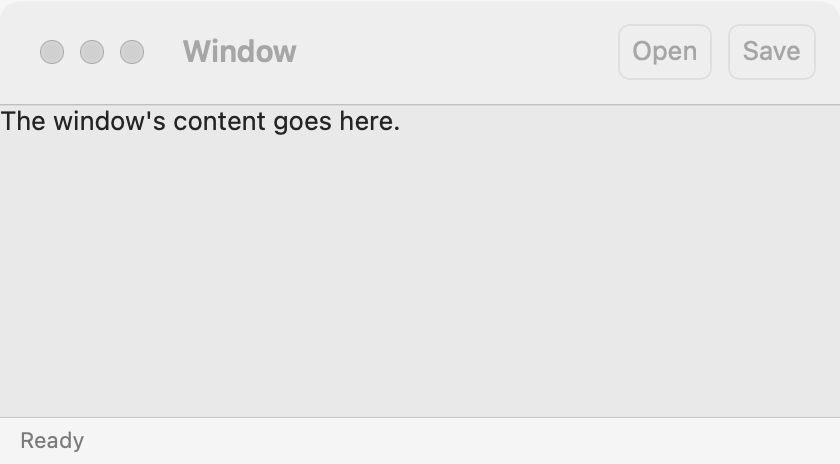

# Window

`GUI_WINDOW` is a top-level native window that holds one content widget, and optionally a toolbar and a status bar. Every program has at least one. Put a [stack](stack.md) or a [grid](grid.md) in it as the content; for a transient panel next to a control, use a [popover](popover.md), and for a question, use [dialogs](dialogs.md).

## Example

```eiffel
class
	NOTES

create
	make

feature {NONE} -- Initialization

	make
		local
			l_toolbar: GUI_TOOLBAR
			l_clear: GUI_BUTTON
		do
			create app.make ("Notes", "org.example.notes")
			create window.make ("Notes", 480, 320)
			create notes.make
			notes.set_accessible_label ("Notes")
			create l_toolbar.make
			create l_clear.make ("Clear")
			l_clear.click_actions.extend (agent notes.set_text (""))
			l_toolbar.extend (l_clear)
			create status.make
			window.set_toolbar (l_toolbar)
			window.set_status_bar (status)
			window.set_content (notes)
			window.close_requested_actions.extend (agent on_close)
			window.show
			app.run
		end

feature -- Access

	app: GUI_APPLICATION

	window: GUI_WINDOW

	notes: GUI_TEXT_AREA

	status: GUI_STATUS_BAR

feature {NONE} -- Events

	on_close
		do
			if app.dialogs.confirm ("Close Notes?", "Your notes are not saved.") then
				window.close
			else
				status.set_text ("Still open.")
			end
		end

end
```

## Try it

A window titled "Notes" opens with a **Clear** button in its toolbar, a text area, and an empty status line at the bottom. Type some text, then click **Clear**: the text goes. Click the window's close button: `close_requested_actions` fires and the program asks "Close Notes?". Choose **Cancel** and the window stays, with "Still open." in the status line. Choose **OK** and `window.close` runs; that was the last window, so the application quits.

## API

| Feature | What it does |
|---|---|
| `make (a_title, a_width, a_height)` | A window titled `a_title`, `a_width` by `a_height` logical pixels. Needs the application (`has_application`); `a_width > 0` and `a_height > 0`. A new window is open (`not is_closed`). |
| `title` | The title. |
| `set_title (a_title)` | Change the title. The window must be open. |
| `content` | The content widget, or Void before `set_content`. |
| `set_content (a_widget)` | Make `a_widget` the content. The window must be open and have no content yet; `a_widget` must have no parent and must not be the window. The widget takes the window's direction. |
| `toolbar` | The toolbar, or Void. |
| `set_toolbar (a_toolbar)` | Give the window a [toolbar](toolbar.md). The window must be open and have no toolbar yet; `a_toolbar` must have no parent. |
| `status_bar` | The status bar, or Void. |
| `set_status_bar (a_bar)` | Give the window a [status bar](status-bar.md). The window must be open and have no status bar yet; `a_bar` must have no parent. |
| `show` | Put the window on the screen. The first `show` also installs the shortcuts of the application's [menus](menus.md). |
| `close` | Destroy the window. The window must be open; afterward `is_closed` is true. When the last open window closes, the application quits. |
| `is_closed` | Has `close` run? |
| `close_requested_actions` | Agents run when the user asks to close the window. See **Events**. |
| `set_base_direction (a_direction)` | `Direction_auto`, `Direction_left_to_right` or `Direction_right_to_left`. The window passes it to its content, toolbar and status bar, and they pass it on to every child that has not set its own. |
| `width`, `height` | The current size in logical pixels; 0 before the window is shown. |

`enable`, `disable`, `hide`, the accessibility features and the rest are the [common features](widget.md).

**Size:** `a_width` and `a_height` are logical pixels, so a 480 by 320 window covers 960 by 640 device pixels on a 200% screen. The size is where the window starts. If the content needs more room, the window opens large enough to show all of it, as GTK and AppKit open a window at its content's natural size. On macOS the size is the content area: the toolbar adds to the title bar, and the status bar takes the bottom 24 points of that area, with the content ending above it.

**Events:** `close_requested_actions` fire when the user asks to close the window (its close button, for example). With no agents, the window closes itself. With agents, the window stays open, and your agent decides: call `close` to close it. Calling `close` from code fires nothing.

**Accessibility:** a window's role is `application`, named by its title. Give the window a title that says what it holds.

## On each platform

| | Linux (GTK 4) | macOS (AppKit) | Windows (simple_widgets) |
|---|---|---|---|
| Native control | `GtkWindow` | `NSWindow`, titled, closable, minimizable and resizable | an `SW_WINDOW` on simple_shell |
| Menu bar | a `GtkPopoverMenuBar` at the top of each window, hidden while the application has no menus | the screen's menu bar, shared by every window | a menu bar in each window |
| Toolbar | a strip above the content | an `NSToolbar` in the title bar | a strip above the content |
| Status bar | a strip below the content | a line in the window's bottom bar | a strip below the content |
| Looks or behaves differently | The size is the window's default size. | The green button and **Window > Enter Full Screen** take the window full screen. `close` orders the window out. | A second window opened while another is open is a floating document window of the first, with the same menu bar. Screen readers do not see a second window yet. |

## Design guidance

- Give each window one content widget that fills it, usually a vertical [stack](stack.md) with one stretching child, so the window resizes well.
- Ask for the size your content looks good at. If you ask for too little, the window opens larger, so do not rely on a small size to hide anything.
- Build the [menus](menus.md) before the first `show`: that call installs their shortcuts.
- Keep `close_requested_actions` short: confirm unsaved work, then `close`. With no agent, the window simply closes, which is right for most windows.
- For a right-to-left language, call `set_base_direction (window.Direction_right_to_left)` on the window, not on each widget. Numbers keep their own order (see [label](label.md)).
- Do not put a toolbar or a status bar in the content yourself. `set_toolbar` and `set_status_bar` put them where each platform's users look for them.

## Gallery

| Linux | macOS | Windows |
|---|---|---|
| <!-- PROD: Linux picture --> |  | <!-- PROD: Windows picture --> |
