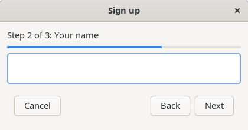
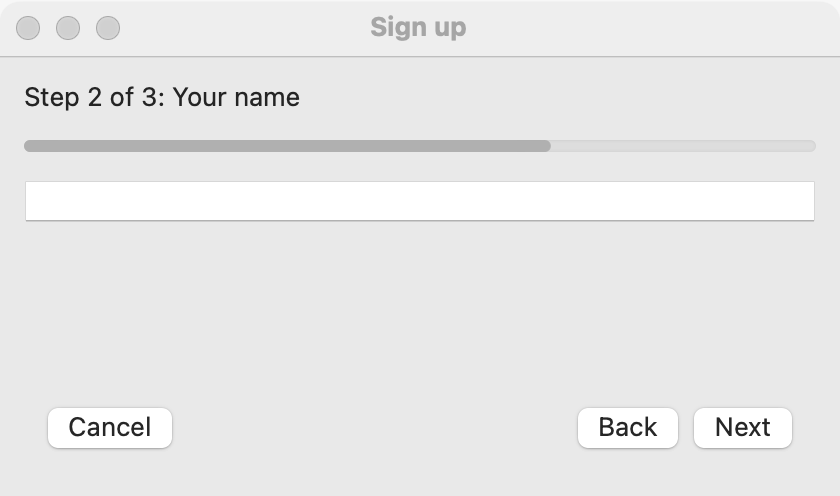
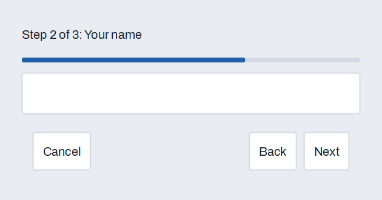

# Wizard

`GUI_WIZARD` takes the user through steps in order: a header ("Step 2 of 3: Address"), a progress bar, the step's page, and **Back**, **Next** (**Finish** on the last step) and **Cancel**. Each step can check its page before the user goes on. Use it for setups and forms too long for one page (W3Schools' "multiple step form"). For pages the user moves between freely, use [tabs](tabs.md) or a [sidebar](sidebar.md).

## Example

```eiffel
class SIGN_UP create make
feature
	app: GUI_APPLICATION
	wizard: GUI_WIZARD
	name: GUI_TEXT_FIELD

	make
		local
			l_window: GUI_WINDOW
		do
			create app.make ("Sign up", "org.example.sign-up")
			create l_window.make ("Sign up", 480, 320)
			create wizard.make
			create name.make
			name.set_validator (agent (t: STRING_32): detachable STRING_32
				do
					if t.is_empty then Result := {STRING_32} "Please type your name" end
				end)
			wizard.extend_step (create {GUI_LABEL}.make ("Welcome. This takes a minute."), "Welcome")
			wizard.extend_step (name, "Your name")
			wizard.extend_step (create {GUI_LABEL}.make ("Press Finish to sign up."), "Confirm")
			wizard.set_can_advance (2, agent has_name)
			wizard.finish_actions.extend (agent sign_up)
			wizard.cancel_actions.extend (agent l_window.close)
			l_window.set_content (wizard)
			l_window.show
			app.run
		end

	has_name: BOOLEAN
			-- Step 2 may go on once a name is typed; `validate' shows why not.
		do
			name.validate
			Result := name.is_valid
		end

	sign_up
		do
			print ("Welcome, " + name.text.to_string_8 + "%N")
		end
end
```

## Try it

The window opens on "Step 1 of 3: Welcome", with **Back** off. Press **Next**. On step 2, press **Next** with the field empty: the wizard stays, and the field says why. Type a name and press **Next**: step 3 shows **Finish**. Press **Finish** and the program prints its welcome. **Back** goes back a step at any point; **Cancel** closes the window.

## API

| Feature | What it does |
|---|---|
| `make` | A wizard with no steps. Ensures `step_count = 0` and `step = 0`. |
| `extend_step (a_page, a_title)` | Adds a step showing `a_page`. The first step added is shown. |
| `set_can_advance (i, a_check)` | Step `i`'s check, a `FUNCTION [BOOLEAN]` asked when the user presses **Next** or **Finish** there; False stays on the step. Void: none. |
| `can_advance (i)` | What step `i`'s check answers now (True without one). |
| `step`, `step_count`, `step_title (i)` | The step shown, how many there are, their titles. |
| `go_to_step (i)` | Shows step `i`, with no event and no check. |
| `refresh` | Sets the header, progress and buttons for the current step again. |
| `back_button`, `next_button`, `cancel_button` | The buttons, for tests and for making **Next** the window's default button. |
| `step_changed_actions` | `GUI_ACTIONS [TUPLE [step: INTEGER]]`: run after the user's **Back** or **Next** moved to another step. |
| `finish_actions` | Run when the user's **Finish** passed the last step's check. |
| `cancel_actions` | Run when the user presses **Cancel**. |

**Events:** `step_changed_actions`, `finish_actions` and `cancel_actions` fire only for the user's buttons. `go_to_step` fires nothing. A check that answers False fires nothing either; the step's page should show why, as a field's [validation](validation-and-suggestions.md) does.

**Accessibility:** the header is read as the step's title and number; the buttons are ordinary buttons.

## On each platform

`GUI_WIZARD` is built from simple_gui's own [label](label.md), [progress bar](progress-bar.md), [tabs](tabs.md) with no tab strip, and [buttons](button.md), so each part is native and the wizard looks at home on each platform.

| | Linux (GTK 4) | macOS (AppKit) | Windows (simple_widgets) |
|---|---|---|---|
| The page area | `GtkNotebook` without tabs | `NSTabView` with no tabs and no border | `SW_TABS` with no strip |

## Design guidance

- Keep it to three to seven steps, and say in each title what the step is for.
- Check a step when the user presses **Next**, not on every keystroke, and show the reason beside the field that needs it.
- Make the last step a summary the user confirms with **Finish**; nothing should happen before then.
- Let **Back** keep what the user typed.

## Gallery

| Linux | macOS | Windows |
|---|---|---|
|  |  |  |
